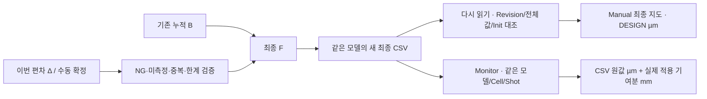

# 일괄보정 저장·최종 CSV·Monitor 일치 · 11.24.6

11.24.5 `0103581022bfba6fe7a7b050cd357ceefbee7143` 기반. 이번 변경은 새 `feature/manual-inspection-bulk-final-consistency-20261124.6` 브랜치에서 진행하며 master에는 병합하지 않는다.

## 확인한 원인

- 일괄보정 → 기존 CSV 저장기의 연결은 이미 있다. ‘측정 편차 Level’은 이번 편차 **Δ**, ‘최종 Review 보정 Level’은 저장된 누적값 **F**이므로 색상이 서로 다를 수 있다. 직접 측정의 관계는 **기존 B + Δ = F**, 대표값 복사는 **대표 F를 절대값으로 지정**한다.
- NG·미측정·이미 사용한 측정·수치 한계 초과인 점은 저장 대상에서 제외된다. 편차를 편집했어도 이 조건에 해당하면 최종 파일은 바뀌지 않는다. 한계를 자동으로 높이지 않는다.
- 최신 파일이 외부에서 바뀐 뒤 작업을 재연결할 때 작업 기준만 갱신하고 최종 지도 캐시가 남을 수 있었다.
- CSV 쓰기 이후 재조회가 실패해도 성공 문구로 덮일 수 있어, 파일 저장과 표시 확인의 상태가 불분명했다.
- Monitor에서 명시적으로 선택한 모델을 찾지 못하면 첫 번째 다른 모델로 대체할 수 있었다. Manual Inspection과 다른 모델의 최종 파일을 비교하게 되는 잘못된 경로다.
- Monitor가 CSV를 읽는 동안 모델이 바뀌면 늦게 도착한 이전 모델 자료가 표시될 수 있었다. 전환 중에는 이전 모델의 좌표·보정값을 비우고 현재 모델을 다시 읽는다.

## 바뀐 동작

1. 일괄/선택/대표값 보정과 Undo/Redo의 저장 후 최신 CSV를 다시 읽고, 저장 Revision·전체 위치의 값·초기화 상태를 대조한다.
2. 파일 저장과 재조회 결과를 구분한다. 이미 저장된 CSV의 재조회 실패를 ‘미저장’으로 취급해 같은 측정을 다시 누적하지 않는다.
3. 새 저장 파일을 확인한 경우에만 지도와 산포도를 ‘최종 Review 보정’ 보기로 전환한다. 편차 입력만으로 최종 지도 값을 바꾸지 않는다.
4. 외부 파일 변경으로 작업을 다시 연결하면 최종 저장값도 새로 읽는다. 수치 한계 등 제외 수와 저장 확인 상태를 표시한다.
5. Monitor는 존재하지 않는 선택 모델을 다른 모델로 대체하지 않는다. Shot Detail의 별도 정보에서 **같은 CSV 파일·SHA·모델·Cell/Shot·저장된 DESIGN µm 값**을 확인할 수 있다.

Monitor의 기존 `REVIEW OFFSET` 행은 **현재 좌표계의 실제 적용 기여분(mm)**이다. CSV 원값은 **DESIGN µm**로 비교한다. SCANNER 축 변환과 `REVIEW_OFFSET_SCALE`이 있으므로 두 숫자가 그대로 같아야 하는 것은 아니다. 실제 좌표 계산식과 적용 비율은 바꾸지 않았다.

최종 파일 위치는 계속 `Config/RECIPE/<모델>_reviewoffset/<시각>_reviewoffset.csv`다. 과거 CSV는 이력이며 마지막 활성 CSV 하나가 누적 최종값이다. 별도의 중복 final 저장소를 만들지 않는다.

## 확인 방법

같은 모델·Cell·Shot의 편차를 입력한 뒤 일괄보정을 확인한다. 새 CSV 파일명이 바뀌고 저장 재확인이 완료되면 최종 지도 값과 Monitor의 **CSV 저장값(DESIGN µm)**을 비교한다. `REVIEW OFFSET` 적용 기여분과는 단위·좌표계·Scale을 맞춰 비교한다. 저장 제외 또는 재확인 실패가 표시되면 해당 사유를 먼저 확인한다.

[Controller](../../Drilling.UI/Menu/Menus/CManualInspectionController.cs) · [기존 CSV 저장 연결](../../Drilling.UI/Menu/Menus/CManualInspectionBackend.cs) · [Monitor](../../Drilling.UI/Menu/Menus/CMenuMonitor.cs) · [표시용 CSV 스냅샷](../../Drilling.UI/Menu/Menus/CReviewOffsetDisplaySnapshot.cs) · [검증 기록](validation.json)

실제 장비 Manager가 필요한 생산 저장 동작은 실행하지 않는다. 소프트웨어 시험은 실제 Controller·CSV 변환/저장기·Monitor 표시 코드를 합성 데이터와 장비 없는 저장 연결로 검증하며, PLC/Vision·모션·레이저·실기 정밀도 합격을 뜻하지 않는다.

## 합성 재현 결과

| 기존 B (µm) | 입력 Δ (µm) | 새 최종 CSV F (µm) | 결과 |
| --- | --- | --- | --- |
| 18 / −3 | 5 / 1 | 23 / −2 | CSV 0.023 / −0.002 mm, 최종 지도·Monitor DESIGN 값 일치. 편차 L1과 최종 L4는 정상적인 차이 |
| 500 / −700 | 5 / 1 | 기존값 유지 | 누적 한계 200µm 조건에서 제외 1점·저장 0회. 저장됐다고 표시하지 않음 |

추가로 외부 CSV 교체 후 재연결, 쓰기 성공 뒤 재조회 실패와 복구, 후속 CSV 쓰기, 같은 입력 재적용 차단, Undo/Redo, 값 없음/Init/실측 0 구분, Monitor의 늦은 이전 모델 응답을 시험했다. 재조회가 실패해도 이미 저장한 보정과 사용한 측정 이력은 되돌리거나 다시 누적하지 않는다.

최종 Release 빌드 **경고 0 / 오류 0**, Core **248**, 실제 Controller **269**, Backend/CSV/Monitor **152**, 좌표/CSV writer **35**, 외부 결과 **53**, 범위·보존 **28**, WPF **17모드 1,025** 검사를 통과했다. Controller 소스 연결 preflight 266개는 실제 DLL 시험과 중복 합산하지 않았다. 3회 교차검토와 작은 다크/큰 라이트 화면의 글자 잘림도 확인했다.

실제 오류가 발생한 다른 PC의 설치 버전·운영 CSV는 직접 열어 확인하지 못했다. 위 값은 운영 데이터가 아닌 합성 시험값이다.
