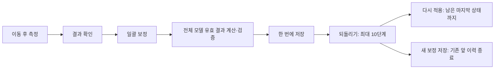

# 일괄 보정·되돌리기·값 없는 초기화 · 11.23.0

기준 `61578dbefbef8d5d5ebe83e4ec289e452771904f`의 후속이다. 브랜치는 `feature/manual-inspection-bulk-history-20261123.0`이며 master에 병합하지 않는다. [화면 사용법](README.md) · [검증 manifest](validation.json)

## 측정과 보정을 분리한다

**이동 후 측정**은 이동 확인·도착/정지·측정 응답을 처리하고, 오른쪽에 최신 측정값과 판정을 보여준다. 보정을 자동 저장하지 않는다. **이동 후 측정 및 보정**은 화면에서 제거했고 이전 요청 경로도 거부한다. 현 위치 측정은 확인된 한 점을 이동 없이 측정한다.

**일괄 보정**은 지도에서 보이는 점이나 선택한 점만이 아니라 **현재 모델 전체**를 검사한다. 실행 대상과 제외 수를 보정 영역에 표시한다.

| 결과 | 일괄 보정 처리 |
| --- | --- |
| 새 직접 측정 OK | 현재 기준과 일치하는 유효 편차를 누적 보정에 반영 |
| 명시적으로 불러와 검증된 파일 측정 OK | 파일 출처·현재 좌표 기준 확인 후 반영 |
| 유효한 대표값 복사 OK | 사유·원본 계보를 확인하고 복사한 최종값으로 반영 |
| NG | 빨강으로 표시하며 제외 |
| Masking·미측정·초기화 | 제외 |
| 이미 적용한 동일 측정 | 다시 더하지 않고 제외 |
| 보정 기반 표시 이력만 있는 점 | 새 직접 측정으로 바꾸지 않으며 제외 |

같은 Cell/Shot의 Beam은 저장할 보정값 하나를 공유한다. 여러 Beam의 최종값이 서로 다르면 임의로 하나를 고르지 않고 저장을 막는다. 증감·총량·Field·모델/가공 회차·좌표 기준도 검증한다. 대상 중 검증 오류가 있으면 일부만 조용히 저장하지 않는다. 파일 저장이 실패하면 실제 활성값과 이력 위치를 유지한다.

별도 측정 없이 일괄 보정을 반복해 같은 오차를 누적하지 않는다. 대표 복사는 잔차를 무조건 한 번 더 더하는 방식이 아니라 확인한 최종값을 사용한다. 직접 측정한 0도 유효한 결과이며, 초기화한 빈 상태와 구분한다.

## 되돌리기와 다시 적용

**되돌리기**는 바로 이전 보정 상태로 이동한다. 최대 10단계까지 가능하며 버튼에 남은 횟수를 표시한다. **다시 적용**은 되돌린 뒤 다음 저장 상태로 진행하고, 남아 있는 가장 최근 적용 지점까지 갈 수 있다.

예를 들어 `A → B → C`를 적용한 뒤 B로 되돌리면 C로 다시 적용할 수 있다. B에서 새 D를 저장하면 적용 흐름은 `A → B → D`가 된다. C는 앞돌리기 대상에서 빠지지만 과거 저장 파일·감사 기록을 삭제하는 것은 아니다.

- 이력에는 보정 숫자와 초기화/값 없음 상태를 함께 보관한다.
- 되돌리기·다시 적용은 실제 파일 저장에 성공한 뒤에만 이력 위치를 바꾼다. 실패·취소는 현재 상태를 유지한다.
- 저장된 작업을 정상 복구하면 되돌린 위치와 남은 앞 이력을 함께 복구한다. 이 기능이 없는 구형 작업은 현재 활성 상태를 새 기준으로 시작한다.
- 모델·외부 활성 파일·좌표 기준이 달라지면 맞지 않는 이전 이력을 재사용하지 않는다.
- 물리 이동은 수행하지 않는다. 보정 파일을 새 버전으로 저장하며 기존 파일은 보존한다.

보정 기준이 바뀐 Shot의 옛 작업 편차·대표 복사·파일 채택 자격은 해제한다. 예전 기준으로 측정한 편차를 새로운 B에 다시 더하지 않기 위해서다. 원측정과 변경 이력은 남긴다. 이미 소비한 원측정 기록도 되돌리지 않으므로 Undo를 같은 오차 재누적의 우회 경로로 사용할 수 없다. 저장된 보정값을 복구하려면 **다시 적용**, 새로운 잔차를 얻으려면 **재측정**을 사용한다.

원복 대상은 현재 모델의 Cell/Shot 보정 맵이다. 현재 모델 기하에 없는 과거 CSV 행 전체를 임의의 이전 파일로 교체하는 기능은 아니다.

## 모든 Review의 Offset Init은 ‘값 없음’

초기화는 정확히 측정한 오차가 0이라는 뜻이 아니다. Review 보정값이 없다는 뜻이다. 모든 Review의 Offset Init 경로에 이 상태를 반영한다.

| 상태 | 결과 표시 | 좌표 계산 |
| --- | --- | --- |
| 적용 보정과 새 측정이 모두 없음 | 미측정·회색, 편차·Level 없음 | 측정 보정을 더하지 않음 |
| Offset Init | 값 없음·회색, 유효 산포에서 제외 | 측정 보정을 더하지 않음 |
| 실제 측정한 X/Y=0 | 유효한 실측 0, 판정·Level 표시 | 검증 후 적용 가능 |
| 정상 적용된 측정 보정 | 측정 또는 보정 기반 이력으로 구분 | 저장된 누적값 사용 |

계산 내부의 중립값 0과 화면의 측정값 0은 별개다. 현재 CSV의 초기화 상태와 적용 행 유무를 실제 기준으로 읽어, 카메라 새 측정 표시와 저장된 보정 기준도 구분한다. 적용 보정이 없어도 새 OK/NG 결과를 받았다면 그 실측을 표시한다. 처음 비어 있던 모델에 첫 보정을 적용한 뒤 되돌리면 빈 보정 기준으로 돌아간다.

Manual Inspection에서는 전체 / Cell / Head 범위를 선택해 화면 초안을 만든다. **모델 Offset 저장** 전까지 실제 활성값은 유지하고, **Offset 편집 취소**로 취소할 수 있다. 다른 Review 메뉴도 초기화한 값을 정상 0 편차나 OK 측정으로 만들지 않는다. 기존 측정/보정 파일을 삭제하지 않는다.

초기화 범위는 측정에서 누적된 Review 보정이다. **하드웨어·Default Offset·First Beam Offset·Distortion은 보존한다.** 같은 Cell/Shot의 Beam은 한 저장값을 공유하며, Cell/Head 범위 밖은 유지한다. Head를 알 수 없는 옛 행을 Head 범위로 임의 초기화하지 않는다.

행별 초기화 시각은 실제로 초기화하거나 빈 상태로 되돌린 행에만 갱신한다. 보정이 없는 다른 행을 저장 과정에서 새로 초기화한 것처럼 만들지 않는다. 그렇지 않으면 이미 들어온 새 OK/NG 결과를 오래된 결과로 오인해 숨길 수 있기 때문이다. 원측정 이력은 보존하고 새 측정이 있으면 그 판정·편차를 그대로 확인한다.

## 검증 범위

[QA 설명](../../tests/ManualInspection/BULK_HISTORY_QA.md)과 [manifest](validation.json)에 최종 시험 수치·소스/Assembly/그림 SHA를 기록한다. 순수 엔진, 실제 Controller에 주입한 fake Backend, 합성 CSV/Recipe/Backend 연결, 실제 WPF 합성 렌더를 구분한다. 실제 설비 App/Root/Manager·벤더 SDK·PLC/Vision·모션·AeroScript·레이저·물리 정밀도는 실행 검증하지 않았다.

이 설명은 소프트웨어의 상태 처리·저장·화면 동작 범위다. 실물에서의 도착/정지·트리거 수·통신 지연·가공 정밀도는 현장 검증 대상이다.
