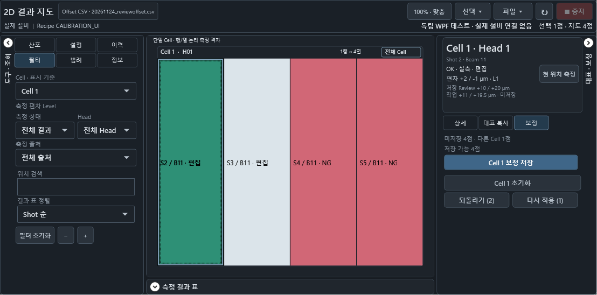

# Manual Inspection · 간단한 조작과 올바른 보정 기준 · 11.24.9

기준은 11.24.8 `dc3a15e6ebc382c6f14d76a916c6b7c510e25590`이다. `feature/manual-inspection-calibration-basis-20261124.9`에서 수정하며 master에 병합하지 않는다.

## 사용자는 세 단계로 작업한다

1. 지도에서 점을 선택하고 **이동 후 측정**한다.
2. 필요하면 대표점을 정해 **대표값 복사** 또는 우클릭의 보정값 직접 입력을 사용한다.
3. **현재 Cell 보정 저장**으로 확인·저장한다.

현재 편차·저장 Review·짧은 작업 상태를 확인한다. 계산·좌표 변환·출처·중복·Field 검증은 내부에서 처리한다. 새 탭이나 필수 가공 기준 입력창을 추가하지 않는다. 기본 2D 지도와 기존 테마·키보드·우클릭·숫자 키패드는 유지한다.

## 실측 잔차와 최종값을 구분한다

| 입력 | 내부 의미 | 저장 정책 |
| --- | --- | --- |
| 실제 Vision 측정 | 해당 구멍에 남은 잔차 | 실제 가공 당시 적용값에 잔차를 반영해 다음 가공의 최종값 계산 |
| 대표값 복사 | 대표점에서 검증·계산한 최종 Review 값 | 대상의 기존 Review에 더하지 않고 그 값으로 교체 |
| 파일 가져오기 | 명시적인 절대 Review 값 | 현재 Cell의 작업값으로 준비한 뒤 교체 저장 |
| 보정값 직접 입력 | 작업자가 지정한 절대 Review 값 | 원측정과 분리해 기록하고 교체 저장 |

기존 10 µm를 적용해 가공한 구멍에서 잔차 2 µm가 측정됐다면, Scale 100%의 다음 Review 값은 **12 µm**다. 이 12 µm를 다른 점에 복사하면 대상의 기존값이 20 µm여도 **12 µm**로 바뀐다. 2 µm로 기존 보정을 지우거나, 20+12로 이중 가산하지 않는다.

## 실제 가공 기준을 사용한다

기준은 측정할 때 선택된 최신 CSV를 추측한 값이 아니라, 실제 가공에 사용된 Recipe/Glass/Process·좌표 기준·Review CSV SHA·적용값·Scale에 연결한다. 필요한 정보만 기록하며 설정 전체나 인증정보를 복제하지 않는다.

같은 Scale `s`에서 추천값은 `F = B_run + 잔차/s`다. Scale의 단위는 배율이며 100%는 1이다. 실제 좌표 계획에서 소비된 정밀도·축변환·Scale을 반영한 기준을 사용한다. 가공한 뒤 CSV가 바뀌어도 새 CSV를 옛 구멍의 가공 기준으로 오해하지 않는다.

기준이 없는 과거 기록, 가공 미완료·실패, 모델/좌표/Scale 불일치, Scale 0 등은 실측 자동 보정의 근거로 쓰지 않는다. **이동·측정은 계속 제공**하며, 보정에 필요한 기준이 없다는 사유만 짧게 표시한다. 명시적인 절대값 입력·파일·유효 대표 복사는 실측 잔차와 다른 계약으로 검증한다.

## 표시와 상태도 구분한다

- **측정편차 Level:** 실제 원측정의 편차를 표시한다. 최종 보정값만 있으면 측정값을 발명하지 않는다. NG는 빨강, 유효 실측이 없으면 회색이다.
- **저장 Review:** 선택점의 현재 저장 보정을 짧게 보여준다. 회색이 곧 저장값 없음이라는 뜻은 아니다.
- **작업 상태:** 미저장 / 저장됨·재측정 필요를 구분한다. CSV 재조회 성공은 실제 가공 정밀도가 합격했다는 뜻이 아니다.
- **원측정 산포 / 작업 보정값 산포:** 실측 품질과 대표·수동·파일의 작업값 분포를 구분한다. 복사로 산포가 좁아진 것을 물리 정밀도 향상으로 표시하지 않는다.
- **Undo/Redo:** 모델의 최근 저장 이력을 복원한다. 대상 Cell·시점 안내로 현재 Cell만 되돌리는 동작과 혼동하지 않게 한다.

## 저장·연동·검증

최종 Review CSV는 기존 `Config/RECIPE/<모델>_reviewoffset/`을 그대로 사용한다. 현재 Cell 밖의 값과 원측정·보호 Offset을 보존한다. 다른 Review 메뉴의 기존 계산 방식을 임의 변경하지 않는다. Recipe·Monitor·다음 A1 생성은 같은 최종값을 사용하며, 보정 저장 뒤 가공은 **DoReady를 다시 실행**해 준비한다.

저장 실패·취소·기준 변경과 재시도, 준비된 파일의 동일성, 원측정·실측 0/Init, 대표 복사·동일 결과 중복 방지를 확인한다. Review 값은 Align용 0.001 mm 반올림을 거치지 않으므로 Field 검사도 실제 CSV의 소수 6자리 mm 값과 일치시켰다. 기존 경계의 미세 초과 누락/정상값 오거절을 재현한 뒤 수정했다. 실제 가공 기준의 기록·완료·실패·재시작도 순수 helper와 합성 파일로 검증한다.

이번 검증에는 기존 UI/CSV 회귀와 **새 가공 → 잔차 측정 → 보정 → 다음 가공**의 폐루프 모형을 포함한다. 실제 순수 엔진과 CSV·A1 텍스트 생성 코드를 사용하되, 가공 응답 모형은 가정이며 실기 정밀도를 입증하지 않는다. 설비 App/Manager·PLC/Vision·모션·벤더 API·AeroScript 업로드/실행·레이저는 실행하지 않는다.

[최종 검증 manifest](validation.json) · [이전 동작](REPLACEMENT_WORKFLOW_11.24.8.md) · [Manual 엔진](../../Drilling.Common/Review/ManualInspection/CManualInspectionWorkspace.cs) · [측정·저장 연결](../../Drilling.UI/Menu/Menus/CManualInspectionBackend.cs)

## 확인 결과

Release 빌드는 경고 0·오류 0이다. 순수 엔진 287, 실제 DLL Controller 295, Backend/CSV/Monitor/A1 202, 좌표·저장 38, 가정한 폐루프 35, 이전 JSON 호환 46, WPF 20모드 1,074개를 통과했다. 소스 범위 31개도 통과했다. 서로 다른 시험 범위를 실기 합격률로 합산하지 않는다.

[Light 테마 화면](images/manual-11.24.9-calibration-light.png)
