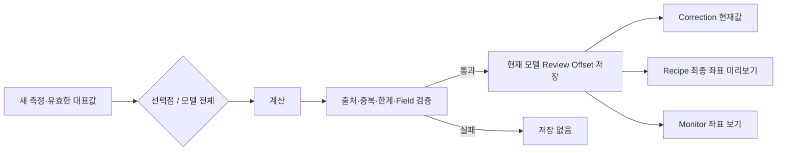

# Manual Inspection · 11.23.1

기준: `367a7276822d73d7709cd64f94847ee979c4d557`. 브랜치: `feature/manual-inspection-cell-click-20261123.1`. master에는 병합하지 않는다.

## 지도 조작

| 조작 | 결과 |
| --- | --- |
| 전체 Cell에서 셀 안 클릭 | 해당 Cell로 들어간다. 측정 타일·빈 내부·Cell 제목·Ctrl+클릭도 같다. |
| 전체 Cell에서 드래그 | 영역 안 측정점을 다중 선택한다. Ctrl+드래그는 기존 선택에 더한다. |
| 방향키 | 화면 안 측정점 선택을 옮긴다. 실제 장비를 움직이지 않는다. |
| Space / Esc | 컨텍스트 메뉴 열기 / 닫기. 메뉴가 열려 있으면 방향키는 메뉴를 조작한다. |
| Alt+방향키·드래그 / Ctrl+휠 / 더블클릭 | 보기 이동 / 확대·축소 / 맞춤. |

회전한 셀의 실제 다각형 범위를 사용하고, 클릭과 드래그를 마우스를 놓을 때 구분한다. Masking·현재 필터에서 숨겨진 점은 새 작업 선택에서 제외한다. 단일 Cell의 Ctrl+클릭 선택은 유지한다.

## 보정 버튼을 두 가지로 구분

| 버튼 | 적용 범위·동작 |
| --- | --- |
| **선택점 보정** | 선택한 유효 측정점으로 계산 → 검증 → 저장을 한 번에 진행한다. |
| **일괄 보정** | 선택·필터와 관계없이 현재 모델 전체의 적용 가능한 새 측정 결과를 적용한다. |
| **초기화 저장 / 가져온 Offset 저장** | 해당 편집이 있을 때만 나타난다. 편집 내용을 검증한 뒤 저장한다. |

‘계산’, ‘검증’, ‘저장’은 내부 단계로 필요하다. 사용자가 세 버튼을 차례로 누를 필요는 없어 평소에는 별도 후보 검증·일반 저장 버튼을 숨긴다. 기존 계산 API와 과거 문서는 호환·검증 용도로 보존한다.

적용 전 확인창은 대상과 효과를 설명한다. 취소하면 후보·파일·보정값을 바꾸지 않는다. 검증·저장에 실패하면 적용 완료로 처리하지 않으며, 연속 클릭·확인창 중첩·확인 중 기준 변경·이미 적용한 측정의 재사용을 막는다. 실제 측정한 오차 0도 첫 적용과 재적용을 구분한다.

**Cell/Shot 단위로 보정값을 저장하므로 같은 Shot의 Beam은 값을 공유한다.** 선택점 보정은 새 보간 알고리즘을 추가하지 않고 기존 직접 측정·대표값 계산과 Scanner Field 검증을 사용한다. Simple/Rough/Fine의 기존 누적 B는 보존한다. 하드웨어·Default·First Beam·Distortion은 변경하지 않는다. 보정 상태는 기존 최대 10회 되돌리기·다시 적용을 지원한다.

## 첫 모델 로드와 다른 화면 갱신

처음 모델을 열 때 측정값이 없어도 이동 후 측정할 수 있다. 이전 실행의 미저장 Init/통합 Offset 초안이 자동 복원되어 잠기는 경우에는 원문 바이트를 `Recovery`에 보관하고 현재 저장된 모델 기준으로 연다. 백업 실패 시 원문을 덮어쓰지 않는다. 현재 작업 중인 미저장 편집·명시적 복원·미완료 측정은 자동으로 버리지 않는다.

저장 파일을 기준으로 화면을 갱신한다. Recipe는 최종 좌표 미리보기용 **복사 맵**에만 Review Offset을 적용하며, 편집 항목·Recipe CSV에 중복 저장하지 않는다. Monitor/Recipe가 보이는 동안 최신 파일의 Revision·SHA가 바뀌면 갱신하고, 같으면 대량 좌표를 다시 만들지 않는다. 늦은 응답은 다른 모델 화면에 적용하지 않는다.

다른 모델에 현재 모델의 보정값을 복사하는 기능이 아니다. 각 화면이 **그 화면에서 선택한 모델의 최신 보정값**을 보여준다는 뜻이다. 원측정 결과표는 과거 측정 원문이며 누적 보정량으로 바꾸지 않는다. Review 카메라 기준 좌표에 누적 B를 임의로 재가산하지 않는다.

## 검증 범위

[최신 검증 manifest](validation.json) · [QA 기록](../../tests/ManualInspection/CELL_CLICK_OFFSET_SYNC_QA.md)

합성 데이터와 실제 소스·Assembly를 연결해 검사한다. 실제 설비 App/Root·벤더 SDK·PLC·Vision·모션·AeroScript·레이저는 실행하지 않는다. 물리 도착·인터락·정밀도는 현장 확인 대상이다.
