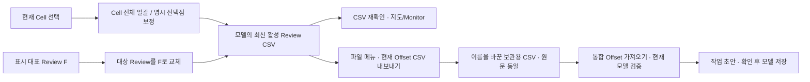

# 현재 Cell 보정·Review Offset 복사·CSV 보관 · 11.24.7

기준은 11.24.6 `d05aec5f4d966232a25580c25ff453aedbfccb20`이다. 새 브랜치 `feature/manual-inspection-cell-csv-workflow-20261124.7`에서 작업하며 master에는 병합하지 않는다.

## 간단해진 파일 메뉴

| 항목 | 동작 |
| --- | --- |
| 통합 Offset 파일 가져오기 | 기존 통합 JSON 또는 최종 Review Offset CSV를 현재 모델의 작업값으로 연다. 확인 후 **모델 Offset 저장**으로 반영한다. |
| 현재 Offset 데이터 내보내기 (CSV) | 현재 모델의 저장된 최종 Review CSV 전체를 같은 형식의 복사본으로 보관한다. 미적용 측정/초안은 포함하지 않는다. |

측정 결과 파일 열기·결과표 CSV·작업 JSON 내보내기·파일 이전 작업 복귀는 파일 메뉴에서 제거했다. 기존 내부 호환 API와 원복 이력은 보존한다. 미저장 Init/가져오기 작업은 먼저 저장하거나 취소한 뒤 파일 메뉴를 사용한다.

## 대표 복사는 Review Offset 교체

대상 Review Offset이 **20µm**, 표시된 대표 Review Offset이 **13µm**이면 대상은 **13µm**가 된다. **33µm로 더하지 않는다.** 하드웨어·Default·First Beam·Distortion 등 다른 종류 Offset은 그대로다.

이 절대 교체 수식은 기존에도 있었으며 이번에는 비영점 기존값을 가진 실제 CSV 저장 연결로 다시 검증하고 확인창·표시 문구를 명확히 했다. 대표의 저장값, 수동 확정값, 복사값, 새 측정으로 계산한 값은 현재 화면에 표시되는 대표 Review F를 기준으로 한다. 새 직접 측정의 F는 대표 자신의 B+Δ로 한 번 계산될 수 있으며, 대상 B에는 복사 F를 다시 더하지 않는다.

NG·미측정·수치 한계 초과·같은 Shot의 Beam 충돌·Field 검증은 유지한다. 같은 복사나 이미 적용한 측정을 다시 눌러 재누적하지 않는다.

## 일괄보정은 현재 Cell 하나

현재 열어 둔 Cell 전체의 새 유효 결과만 계산·검증·저장한다. Head/검색/화면 선택 필터로 Cell 전체 대상이 바뀌지 않으며, 다른 Cell의 보정과 원측정은 유지한다. 전체 Cell 보기에서는 보정할 Cell을 먼저 열어야 한다. 숨은 포커스나 여러 Cell 선택을 모델 전체 보정으로 해석하지 않는다.

확인창을 띄운 동안 Cell이 바뀌면 실행하지 않는다. 선택점 보정은 사용자가 명시적으로 선택한 점에 적용하는 기존 동작을 유지한다.

## CSV 기본 위치와 파일명

- 기본 폴더: **현재 레시피가 실제로 쓰는** `Config\RECIPE\<모델>_reviewoffset`. 사용자 예시 `...\A3Drilling\Config\RECIPE\test0929_reviewoffset`과 같은 모델별 위치이며 PC 사용자명을 하드코딩하지 않는다.
- 기본 이름: 현재 최종 CSV 이름 뒤에 `_export`를 붙인다. 예: `20261124_190000_000_reviewoffset_export.csv`. 저장창에서 이름·위치를 바꿀 수 있다.
- 기존 최종 CSV의 **원문 bytes·열·mm 단위·SPACE·측정/Init 상태·숨은행·정밀도**를 그대로 복사한다. 현재 Cell만 잘라 내보내지 않는다.
- 활성 보정 폴더의 `*_reviewoffset.csv` 이름은 프로그램의 자동 최신 파일 선택 대상이다. 보관용 복사본은 `_export.csv` 같은 이름을 사용한다. 기존 활성/이력 파일은 덮어쓰지 않는다. 동일한 현재 원본 경로를 고르면 원문을 확인하고 변경하지 않는다.
- 일반 보관 CSV를 덮어쓸 때는 저장창의 덮어쓰기 확인을 따른다. 복사 실패·취소·모델 변경 때는 기존 파일과 활성 보정을 유지하고 반쪽 임시 파일을 정리한다.

일괄/선택 보정 자체는 기존처럼 해당 모델의 새 활성 CSV에 저장된다. 파일 메뉴 내보내기는 마지막 저장값에 이름을 붙여 보관하는 기능이며 활성 보정 선택을 바꾸지 않는다.

CSV 형식에는 모델 ID/좌표 서명이 없다. 가져올 때 현재 모델 전체의 Cell/Shot·좌표계·유효 숫자·상태·중복을 검증하고 현재 모델로 연결한다는 설명을 표시한다. CSV에 없는 현재 모델의 Shot은 ‘값 없음’ 초안으로 열리며, 모델 저장 시 해당 Shot의 기존 Review Offset이 초기화될 수 있으므로 필요한 전체 맵인지 확인한다. 출처 모델을 CSV 자체만으로 입증하지 않으며, 다른 모델 이름의 보정 폴더는 거절한다. 새롭거나 변경된 숨은행과 Head 미배정 상태의 SCANNER 좌표는 추정해 적용하지 않는다. JSON의 기존 모델/좌표 서명 검증도 유지한다.

[구현·검증 manifest](validation.json) · [파일/Cell UI](../../Drilling.UI/Views/CManualInspectionView.xaml.cs) · [Controller](../../Drilling.UI/Menu/Menus/CManualInspectionController.cs) · [CSV 연결](../../Drilling.UI/Menu/Menus/CManualInspectionBackend.cs) · [동일 CSV parser](../../Drilling.File/ReviewOffset/CReviewOffsetFile.cs)

실제 Controller·CSV parser/writer·표시 코드는 합성 데이터로 시험한다. 실제 생산 SaveCoreAsync의 설비 Manager 가드, PLC/Vision·모션·레이저·실기 정밀도는 실행하지 않는다. 운영 CSV 레코드는 문서에 복제하지 않는다. 최종 시험 수와 소스/DLL SHA는 manifest를 따른다.

Release 빌드 **경고 0 / 오류 0**, Core **254**, 실제 Controller **277**, Backend/CSV/Monitor **174**(새 CSV 전송 18개·절대 복사/Cell 실CSV 4개 포함), CSV writer **35**, 보존 범위 **33**, WPF **18모드 1,052** 검사를 통과했다. 소스 Controller preflight 274개는 실제 DLL 277개와 중복 합산하지 않는다. 3회 교차검토와 다크/라이트 실제 WPF 메뉴 렌더도 확인했다.
