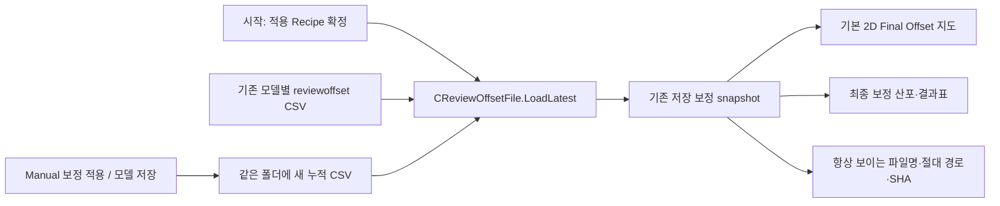
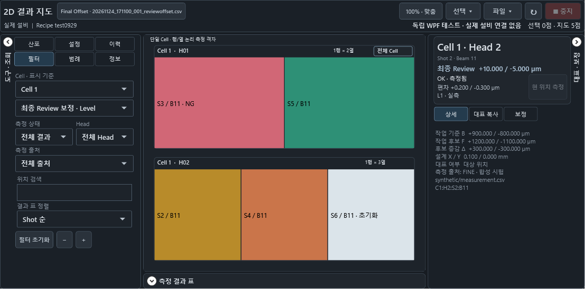

# 기존 Review CSV를 그대로 Final Offset으로 표시 · 11.24.4

기준 `b9659de850691ff677a1e7caf2093c499cd42f28` → `feature/manual-inspection-existing-final-csv-20261124.4`. **master 미병합**.

## 확인 결과

사용자가 지정한 `Config/RECIPE/test0929_reviewoffset`의 최신 CSV가 이미 최종 Review 보정값이다. 기존 `CReviewOffsetFile.LoadLatest(recipeId)`가 폴더 바로 아래 `*_reviewoffset.csv` 중 파일명 내림차순 첫 파일을 읽는다. 가공 준비·Recipe·Monitor·Manual Inspection은 같은 저장소를 사용한다.

검토한 저장소 사본에는 CSV **137개**가 있고, 선택된 최신 파일은 `20261120_114859_908_reviewoffset.csv`다. 기존 읽기 API로 **21,420행 / 45 Cell / 전체 DESIGN**을 확인했다. Cell/Shot 식별자가 현재 모델의 위치 집합과 일치하며 중복·누락·초과는 없다. 이 날짜는 저장소 사본의 조사 결과이며, 현장 PC에서 마지막으로 저장한 파일을 확인했다는 뜻은 아니다.

기존 5열 파일에는 명시적 Init 상태 열이 없다. 파일을 읽었다는 이유로 원문을 초기화하거나 0을 미측정으로 바꾸지 않았다. 전체 CSV의 목록·크기·SHA가 읽기 전후 같음을 확인했다. 운영 레코드 원문이나 실제 보정 수치를 문서에 복제하지 않았다.

## 이번 수정

11.24.3에도 같은 CSV를 2D로 표시하는 연결은 있었다. 다만 기본 보기가 **측정 편차**여서 사용자가 최종 보정 모드를 따로 선택해야 했고, 파일 정보가 접힌 메뉴에 있었다.

- 최초 로딩과 새 모델에서는 **기존 CSV의 Final Offset 지도**를 기본으로 표시한다.
- 프로그램 시작 시 실제 초기 Recipe/Product 준비가 완료된 다음 같은 Recipe의 최종 CSV를 미리 읽는다. 설정의 임시 기본 모델을 먼저 읽지 않는다. 표시 자료 읽기에 실패해도 완료한 가공 준비를 다시 실행하지 않으며 상태 메시지로 알린다.
- 산포도도 처음에는 같은 최종 저장값을 사용한다. 측정 편차·원측정 보기와 사용자가 선택한 보기/파일 복귀 상태는 유지한다.
- 지도 위에 **Final Offset · 현재 CSV 파일명**을 항상 표시한다. 마우스를 올리면 실제 절대 경로·SHA와 조회 상태를 확인한다. 클릭하면 최종 보정 지도/산포로 돌아간다.
- 파일 없음과 읽기 실패를 구분하며, 없는 값을 정확한 측정 0으로 만들지 않는다.

**새 최종 저장소나 별칭 CSV를 만들지 않는다.** 기존 읽기 함수·최신 파일 선택·저장/누적·단위 변환·좌표 계산·회차/형상 검사 및 원 CSV는 그대로 유지한다. 이전의 선택적 내보내기는 최종값의 읽기 원본으로 사용하지 않는다.

Manual Inspection에서 보정을 **적용 / 모델 Offset 저장**하면 기존 저장기가 `Config/RECIPE/<모델>_reviewoffset/`에 시각이 붙은 새 누적 CSV를 만들고, 그 파일을 즉시 다시 읽어 지도·산포·파일명을 갱신한다. 이전 CSV를 덮거나 측정 방식별 값을 다시 전부 합산하지 않는다. 측정만 한 결과, 대표값 복사, 저장 전 Init 초안은 아직 최종 파일을 바꾸지 않는다. 같은 결과를 두 번 적용하는 제한도 유지한다.

## Offset Init 뒤 200 µm 오류와 조작 잠김

Cell/Head만 초기화할 때 범위 밖 값은 `OFFSET_KEEP`으로 그대로 보존된다. 기존 코드는 이 보존값까지 새 보정의 총량 200 µm 제한으로 재검사했고, 실패한 초기화 후보가 남아 이동·측정을 막았다.

- Init에서 **현재 기준과 완전히 같은 보존값**임이 확인된 행은 새 보정량 제한 대상으로 계산하지 않는다. 초기화 대상은 0/값 없음 상태와 Scanner Field를 검증한다.
- 일반 보정과 외부 Offset 가져오기의 한계는 유지한다. 임의의 초과 보정을 새로 허용하는 변경이 아니다.
- 초기화 검증이 실패하면 이전 작업 상태로 돌아가며, 실패한 후보 때문에 이동·측정이 잠기지 않는다. 성공한 Init은 기존처럼 저장 전 초안이며 **모델 Offset 저장 / Offset 편집 취소**로 마무리한다.
- Init 초안에서 한계를 변경하면 승인 상태를 지우고 새 한계로 다시 검증한다. 이미 다른 파일·좌표 기준으로 낡은 후보를 설정 변경만으로 되살리지는 않는다.
- 같은 실행에서 실제 읽거나 저장한 값과 정확히 일치하는 보정 이력만 총량 예외로 복원한다. Field·현재 기준·파일 검증은 유지한다. 재시작 후 근거가 없는 과거 초과값 이력은 자동 허용하지 않는다.

예전 버전에서 남은 Init 초안은 시작 시 자동 적용하지 않는다. 복구 원문을 보관하고 현재 저장 모델을 표시한다. 사용자가 명시적으로 초안을 가져오면 새 정책으로 검증하고, 저장하거나 편집 취소할 수 있다.

실제 ConfigRoot는 실행 환경에 따라 달라질 수 있다. 상단 CSV 표시의 툴팁에 나오는 절대 경로가 현재 프로그램이 읽은 위치다. 저장 누적 보정량은 잔류 측정 오차와 다르며, 원측정/NG 상태를 바꾸지 않는다.

## 근거와 검증

[기존 저장기](../../Drilling.File/ReviewOffset/CReviewOffsetFile.cs) · [시작 레시피 확정](../../Drilling.UI/CRootView.cs) · [ConfigRoot 선택](../../Drilling.UI/CAppStartup.cs) · [기존 Manual 읽기 연결](../../Drilling.UI/Menu/Menus/CManualInspectionBackend.cs) · [2D 표시](../../Drilling.UI/Views/CManualInspectionView.xaml.cs) · [Init 검증](../../Drilling.Common/Review/ManualInspection/CManualInspectionWorkspace.cs)

검증 결과와 현재 소스/DLL SHA는 [manifest](validation.json)를 따른다. 실제 CSV 조사 자료는 파일명·해시·열·집계만 보관하고, UI는 합성 자료를 사용한 실제 WPF 시험이다. 설비 App/Root/Manager·벤더 SDK 실행·실제 통신·모션·레이저는 실행하지 않았다.

Release 빌드 경고/오류 **0/0**. Core **233**, 실제 Controller **249**, 실제 Backend **131**, CSV/좌표 저장 **35**, 외부 결과 투영 **53**, WPF **15모드 917**, 변경 범위 **27** 검사를 통과했다. 소스 링크 Controller 246개는 실제 DLL 검사와 중복 집계하지 않았다.

