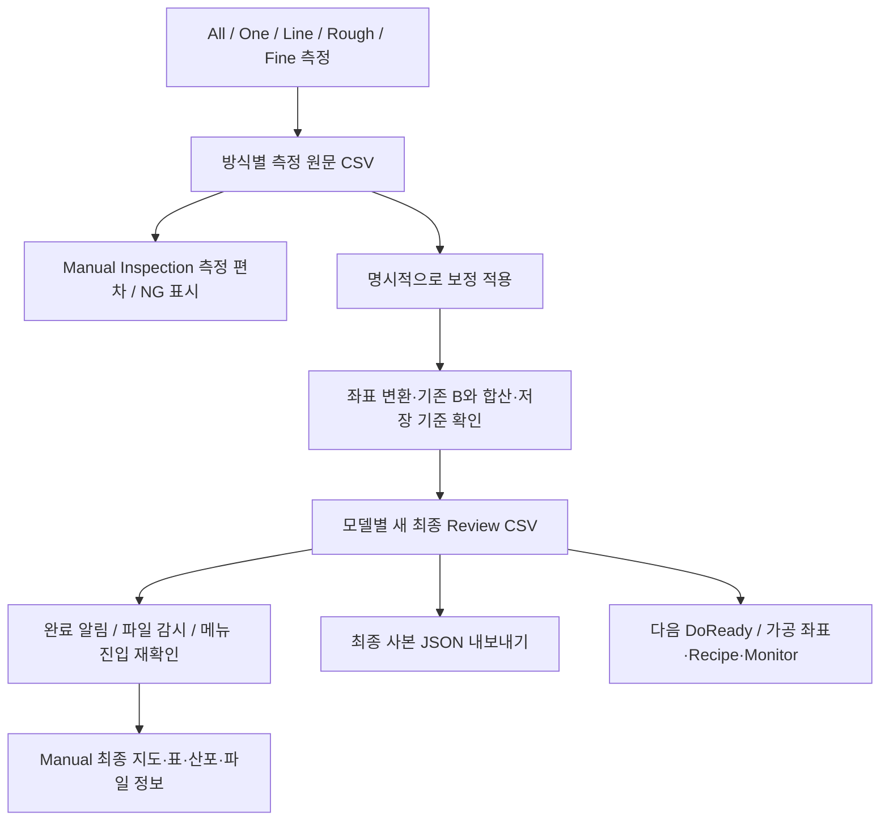
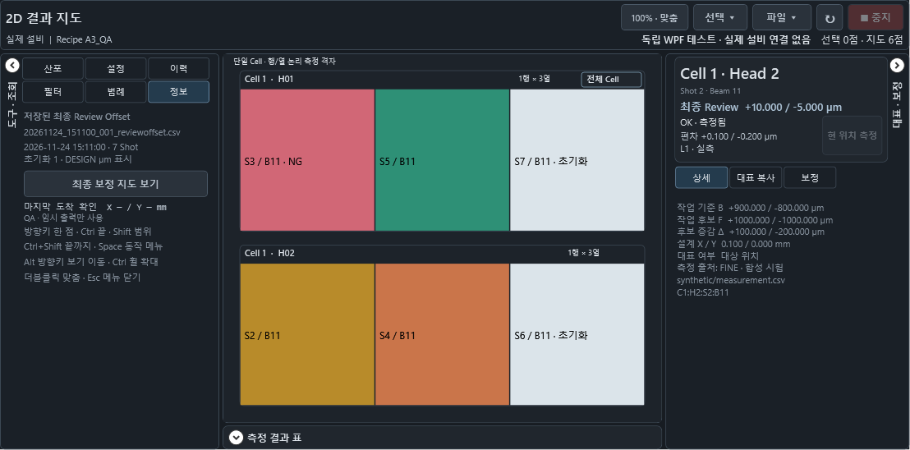
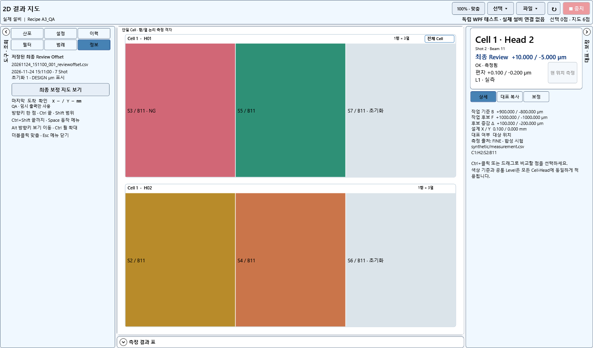

# 최종 Review Offset · 저장·누적·화면 연결

기준: `7de760ccfe57ed75de3b8c9484c0b14114857be0`(11.24.2) → `feature/manual-inspection-final-review-offset-20261124.3`. **master 미병합**.

## 1. 최종 보정 파일은 이미 있다

프로그램에서 실제 선택한 **ConfigRoot**를 기준으로 다음 세 가지를 구분한다. 개발 환경에서는 AppContext 상위의 `Drilling.sln`을 찾은 저장소 루트의 Config를 사용하고, 찾지 못하면 현재 작업 디렉터리의 Config를 사용한다. 설치·실행 방식에 따라 달라질 수 있으므로 **화면의 파일명 툴팁에 표시되는 절대 경로가 실제 위치**다. 아래 경로는 ConfigRoot가 놓인 상위 폴더에서 본 예시다.

| 종류 | 경로 예시 | 의미 |
| --- | --- | --- |
| 검사 원문 | `Data/Review/Manual/test0929/ROUGH/*.csv`, `.../FINE/*.csv`, `.../ONE_SHOT/*.csv` | 어떤 방식으로 무엇을 측정했는지 보관하는 원문. 이것을 저장하는 것만으로 보정이 적용되지는 않는다 |
| 현재 최종 Review 보정 | `Config/RECIPE/test0929_reviewoffset/YYYYMMDD_HHMMSS_fff_reviewoffset.csv` | 해당 모델에 누적 저장된 현재 Review 보정. 폴더 바로 아래의 파일명 내림차순 첫 파일을 읽는다 |
| 휴대·확인용 최종 사본 | 사용자가 고른 위치의 `test0929_final_r<저장시각>.json` | 현재 최종 Review 보정·보호 설정 참고값·계산된 최종 좌표를 한 번에 내보낸 파일. 새 활성 저장소나 새 레시피가 아니다 |

AUTO 원문은 `Data/Review/Auto/test0929/`에 있다. `_apply/YYYY/MM/DD/AppliedSources.csv`는 어떤 원문을 어떤 보정 파일에 적용했는지 확인하는 이력이다. Rollback 하위 파일은 현재 활성 파일 선택에서 제외된다.

**검사 방식별 폴더는 원문 이력 관리용으로 유지하는 것이 맞다.** Rough 최종·Fine 최종을 각각 찾아 가공에 따로 더하는 구조가 아니다. 각 적용 경로가 기존 저장 행을 보존하면서 대상 행을 갱신하고, 새 누적 Review 파일을 만든다.

현재 파일은 저장된 Cell/Shot 행의 누적 스냅샷이다. 레시피 전체의 모든 미측정 Shot을 반드시 행으로 채운 파일은 아니다. **없는 행은 보정 근거 없음이며 정확히 측정된 0이 아니다.** Init 행은 중립 숫자 0과 별개인 ‘값 없음’ 메타데이터를 갖는다. 따라서 행 수가 전체 Shot 수보다 적다고 파일이 누락됐다고 판단하지 않는다.

설계 레시피 CSV와 Default / First Beam / Distortion·Align / Hardware / Shift는 각자의 역할을 유지한다. Review 최종 파일에 다른 보정 종류를 다시 합산해 중복 저장하지 않는다. 가공 좌표를 만들 때 이 성분들을 결합한다. 이후 가공에는 새 저장값으로 DoReady를 다시 해야 하며, 이미 준비된 가공의 보정 기준이 바뀌면 기존 보호가 재준비를 요구한다.

근거: [ConfigRoot 선택](../../Drilling.UI/CAppStartup.cs), [실제 저장기](../../Drilling.File/ReviewOffset/CReviewOffsetFile.cs), [가공 준비·시작 기준](../../Drilling.Common/Station/CStationProcess.cs).

## 2. Rough와 Fine은 방법은 별개이고 최종 Review 값은 공유한다

| 동작 | 실제 계산 |
| --- | --- |
| Rough 적용 | 기존 누적 Review `B` + 선택한 Head / Head+Cell 범위의 새 측정 보정량 |
| Fine 적용 | 기존 누적 Review `B` + Cell 열별로 보간한 새 측정 보정량 |
| All / One / Line 결과 적용 | 기존 누적 Review `B` + 해당 Shot의 새 OK 측정 보정량 |
| Simple 입력 적용 | 선택 범위를 사용자가 입력한 절대 Review 값으로 대체. 잔차 자동 누적과 구분 |

예를 들어 Rough 후 `B=+10 µm`이고, **그 보정을 반영해 다시 가공한 결과**의 Fine 잔차가 `+2 µm`이면 최종은 `+12 µm`다. Fine이 Rough를 지우거나 독립 파일로 분리돼 나중에 두 번 합쳐지는 방식이 아니다.

**보정 저장은 이미 가공된 구멍을 이동시키지 않는다.** Rough 저장 후 재가공하지 않고 같은 구멍을 Fine으로 다시 측정하면 여전히 `+10 µm`가 나올 수 있다. 이를 다시 더하면 `+20 µm`로 과보정된다. 새 파일명이나 새 측정이라는 이유만으로 ‘새로 가공한 결과의 잔차’가 되는 것은 아니다.

Fine의 3줄은 열별 3개 측정점을 사용하는 Lagrange 보간이다. 검사 요청점에 NG·미완료가 있으면 전체 적용을 차단한다. 측정 기준점이 없는 열은 새 보정량을 만들지 않고 기존 B를 유지한다. 누적 보정량의 크기와 실제 잔류 오차의 크기는 다르므로 같은 뜻으로 표시하지 않는다.

근거: [Rough/Fine 적용 호스트](../../Drilling.UI/Menu/Menus/CMenuCorrection.cs), [보간 계산](../../Drilling.Common/Review/CReviewManager.cs), [결과 파일별 적용](../../Drilling.UI/Menu/Menus/CMenuCorrection.ReviewData.Offset.cs), [AUTO 누적](../../Drilling.Common/Review/CAutoFineReviewCoordinator.cs).

## 3. Manual Inspection에서 확인하는 방법

1. **왼쪽 정보:** 현재 최종 파일명·저장 시각·행 수를 확인한다. 파일명에 마우스를 올리면 전체 경로와 SHA-256을 볼 수 있다.
2. **최종 보정 지도 보기:** 왼쪽 정보의 버튼 또는 색상 기준의 **최종 Review 보정 · Level**을 선택한다. 저장된 누적 보정값으로 모든 표시 Cell/Shot을 그린다. 하단 결과표를 펼치면 최종 X/Y도 확인한다.
3. **왼쪽 산포:** **저장된 최종 Review 보정**을 선택한다. 기존 Head/Cell/선택 Cell 범위·Auto/고정 축·확대·맞춤 기능을 그대로 사용한다.
4. **파일 → 최종 보정 파일 내보내기:** 현재 저장 파일을 새로 확인해 모델 전체를 내보낸다. 화면 필터나 열어 둔 옛 측정 파일 때문에 일부 Shot만 저장하지 않는다.

기존 **측정 편차 / OK·NG / 원측정**은 그대로 유지한다. 새 최종 보기는 원측정·후보값을 덮어쓰지 않는다. 미저장 Init·Offset 초안은 **작업 Offset 파일 내보내기**와 구분한다. 최종 보기에서 보정량이 작게 보인다고 가공 정밀도가 좋다는 뜻은 아니다.

아직 저장 파일이 없으면 ‘파일 없음’과 회색 미적용 위치를 보여준다. 읽기 실패나 다른 모델/회차/좌표 기준이면 ‘확인 실패’로 구분하고 옛 값을 최신으로 포장하지 않는다. 유효하게 저장된 실제 0은 값 없음과 구분한다. Head가 미배정된 옛 SCANNER 좌표 행은 임의로 Head 1로 변환하지 않고 진단 후 중단한다. 실제 Head·좌표 기준을 확인한 뒤 다시 조회한다.

## 4. 11.24.3에서 보완한 연결

- 검사 원문 저장과 보정 적용을 구분해 완료 알림을 연결했다. 일반 All/One/Line의 측정 완료만으로 보정을 자동 저장하지 않는다.
- Rough/Fine/Simple/Init/Rollback 종료와 결과 적용 성공을 Manual 화면에 직접 알리고 기존 파일 감시·탭 진입 확인을 유지했다. 선언된 모든 결과 검색 경로도 감시한다.
- 미저장 후보·미완료 측정·열어 둔 파일은 보존하면서, **저장된 최종값만 읽는 독립 조회**로 최신 최종 보정과 원작업을 구분한다. 장비 이동·측정·후보 적용을 자동 실행하지 않는다.
- 역방향 Y 주행에서 Rough/Fine/결과 적용/AUTO의 Stage 오차를 DESIGN 보정으로 저장하는 부호 경계를 통일했다. Vision Flip 이후의 Stage/mm 값을 저장 직전에 한 번 변환하고, 이후 Head/Scanner·Review Scale은 기존 좌표 소비 경로에서 적용한다.
- 계산에 쓴 활성 파일의 경로와 내용 SHA를 실제 저장 잠금 안에서 다시 비교한다. 계산·확인 중 다른 저장이 발생하면 옛 계산값으로 최신 결과를 덮지 않고 다시 계산하도록 한다. 기존 CSV 형식과 중복 적용 확인·원자 저장·원복은 유지한다.

근거: [저장된 값 독립 조회](../../Drilling.UI/Menu/Menus/CManualInspectionBackend.cs), [자동 갱신·상태 분리](../../Drilling.UI/Menu/Menus/CManualInspectionController.cs), [Stage→Design 경계](../../Drilling.Common/Review/CReviewMeasurementOffset.cs).

## 5. 검증과 남은 확인

검증 수·소스/DLL SHA·실행 보고서는 [현재 manifest](validation.json)와 [이번 QA](../../tests/ManualInspection/FINAL_REVIEW_OFFSET_QA.md)를 따른다. 역방향 진단은 기존 256조합 중 128개 불일치를 재현했고, 변환 수정 후 256개가 일치했다. 실제 결과 파일 적용·AUTO·조건부 저장과 최종값 조회·내보내기를 합성 자료/임시 파일로 검증했다.

최종 Release **경고 0 / 오류 0**, Core **221/221**, 실제 Controller **235/235**, 실제 Backend **131/131**, Bridge/Writer **35/35**, 실제 외부 결과 투영 **53/53**, WPF **14종 878/878**, 변경 범위 **32/32**를 통과했다. Controller 소스 링크 232개는 실제 Assembly 검사와 중복 합산하지 않는다.

아래는 장비 접속 없이 합성 자료와 fake Controller로 띄운 실제 WPF 화면이다. 저장된 최종값과 보존된 작업 기준 B/후보 F가 다른 상황을 의도적으로 넣었다.

추가 확인할 사항은 세 가지다.

- **가공 당시 보정 기준:** 기존 결과 CSV만으로 구멍을 가공할 당시의 Review Revision을 항상 증명할 수는 없다. 이번 저장 경쟁 방어와 ‘재가공 후 새 잔차’ 확인은 별개다. 물리적으로 같은 흔적인지를 자동 판정했다고 주장하지 않는다.
- **기존 역방향 저장값:** 새 변환은 이후 계산에 적용한다. 이미 저장된 B를 자동으로 뒤집으면 정상 Manual 값까지 바뀔 수 있어 일괄 변환하지 않았다. 기존 역방향 가공 보정을 사용 중이라면 실제 적용 방향을 확인하고 필요한 항목만 재설정·재가공·재측정해야 한다.
- **실기 검수:** 설비 App/Root/Manager, 벤더 SDK 실행, PLC/Vision 통신, 실제 이동·AeroScript·레이저·기판 가공은 하지 않았다. 실제 인터락·도달 정밀도·보정 성능은 현장 확인 대상이다.
