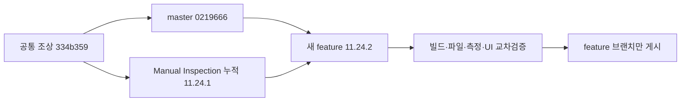
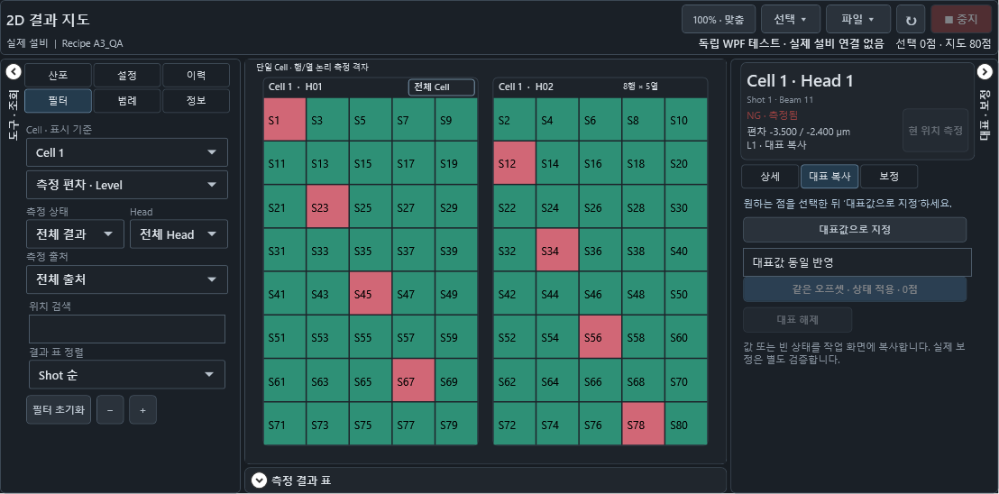
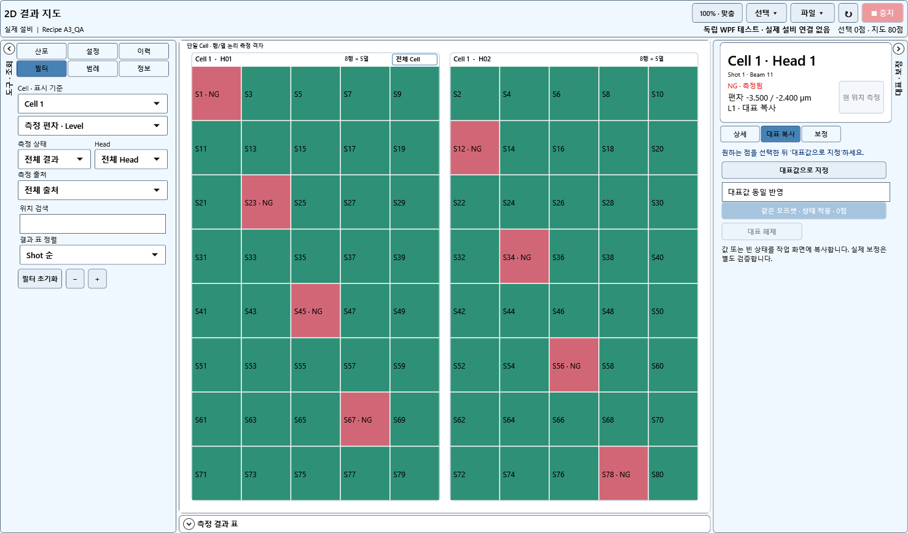

# Manual Inspection · 11.24.2 통합본

브랜치: `feature/manual-inspection-master-integration-20261124.2` · **master 미병합**

| 구분 | 고정 기준 |
| --- | --- |
| 이번 작업의 master | `0219666f9053b907d96d7e0aa7d0c6c1be3a73d4` · Ver 11.23.0 |
| 가져온 Manual Inspection 최종본 | `fb869deb2e02b695c8fd39d57bbd01f80932e5c7` · 11.24.1 |
| 두 이력의 공통 조상 | `334b3599651b2e8e0181fd4459bafaf3cddafff3` |
| 프로그램 / 휴대 Offset 자료 버전 | `2026.11.24.2` / `11.24.2` |

## 무엇을 통합했나

기존 Correction 메뉴를 유지하고 **Correction → Review → Manual Inspection**에 다음 누적 기능을 모두 가져왔다.

| 기능 | 통합된 동작 |
| --- | --- |
| 지도 중심 작업 | 실제 Cell 배치의 전체 보기, Cell 영역 클릭 진입, 드래그 다중 선택, 셀 크기·확대율에 비례한 상시 번호, 꽉 찬 Level 타일 |
| 키보드·확대 | 방향키, Ctrl 끝 이동, Shift 범위 선택, Ctrl+Shift 끝까지 선택, Space 메뉴, Esc 닫기, Ctrl+휠 확대, Alt+방향키 보기 이동, 더블클릭 맞춤 |
| 측정 | 이동만 / 이동 후 측정 우클릭 메뉴, 현 위치 측정, 오른쪽 결과 표시, 현재 측정점 0.5초 점멸, 실패 후 남은 위치 재시도 또는 새 선택으로 진행 |
| 대표 복사 | 모든 점 대표 지정, 숫자·OK/NG 상태 복사, 초기의 값 없는 상태 복사. 원측정·실제 모델 누적 보정값은 별도 보존 |
| 보정 | 선택점·모델 전체 일괄 보정, 적용 확인, 동일 결과 중복 적용 방지, NG·미측정·Masking 및 한계 위반 실제 저장 제한 |
| 이력 | 저장에 성공한 보정값의 최대 10단계 Undo/Redo, 원시 측정값의 재사용·중복 소비 방지 |
| Offset Init | 전체 / Cell / Head 측정 보정 초안 초기화, 없음과 실제 측정 0 구분, 모델 저장·편집 취소. 하드웨어·Default·First Beam·Distortion 설정 보호 |
| 파일·다른 Review | 외부 Rough/Fine 등 측정 및 기존 저장 보정 이력 연결, 파일을 연 뒤 현재 모델에서 측정·보정, 파일 전 작업으로 복귀, 통합 Offset 파일 가져오기·내보내기 |
| 산포·표시 | 공통 측정 Level과 OK/NG, NG 빨간색·값 없음 회색, Cell/Head/선택 Cell 산포, Auto/고정 축·확대·더블클릭 맞춤, 원측정/작업값/적용값 구분 |
| 레이아웃 | 왼쪽 필터·범례·작업정보·산포·설정·이력, 오른쪽 선택점·대표 복사·보정, 하단 결과표. 중앙과 양쪽 패널의 외부 스크롤 없이 페이지 조작 |
| 다른 화면 | 같은 모델에 저장한 Review Offset을 Recipe·Monitor Coordinate Viewer/Shot Detail·Correction에서 새로 반영, 좌표계·스케일 및 없음/실제 0 구분 |

대량 결과표·통계 목록의 국소 스크롤은 유지한다. **이동 후 측정 및 즉시 보정** 동작은 되살리지 않았다. 측정과 보정 저장은 구분한다. 빈 상태를 복사하는 것은 실제 모델 보정을 지우거나 미측정을 합격으로 바꾸는 동작이 아니다.

## master의 새 기능은 어떻게 유지했나

- master 기준 새 브랜치에서 3-way merge했다. master 고유 변경 **1,601파일**, master의 전체 Config/Data **2,051파일**을 보존했다. 기존 운영 레코드를 문서에 복제하지 않는다.
- feature가 바꾼 **239파일**(생산 소스 29개·전용 문서·테스트)을 모두 반영했다. 삭제·누락 없이 파일별로 대조했다.
- 양쪽이 수정한 파일은 두 개다. `Drilling.UI.csproj`는 버전을 `.2`로 정했고, `CMenuMonitor.cs`는 충돌 없이 양쪽 변경을 합쳤다. 별도 재구성으로 합쳐진 전체 본문도 검증했다.
- Monitor의 MELSEC 그룹 선택·즉시 갱신, STAGE PC DATA / DUMMY Glass 생성, Product 필드 표시를 유지하면서 Manual Inspection의 최신 Review Offset 표시 갱신을 함께 적용했다.
- master의 Product/MELSEC 코드·Monitor XAML·시뮬레이션 창·Glass 선택창과 전역 테마를 보존했다. Manual Inspection의 연계 코드 외에 다른 기능을 새로 설계하거나 변경하지 않았다.

## 검증과 한계

이번 통합 코드에서 Release 빌드, 순수 엔진, 실제 Controller Assembly, 실제 Backend/CSV, 좌표 변환·저장기, 외부 결과 투영 및 실제 WPF 13종을 다시 실행했다. [현재 manifest](validation.json)에 보고서·개수·소스와 DLL SHA를 기록했다. 이전 `.1` 보고서는 [별도 이력](history/validation-fb869de.json)에 보존했다.

Release **경고 0 / 오류 0**, Core **221/221**, 실제 Controller **214/214**, 실제 Backend **111/111**, Bridge/Writer **35/35**, 외부 결과 투영 **53/53**, WPF **13종 843/843**, 통합 범위 **40/40**을 통과했다. Backend의 새 4개는 master의 전체 Product 필드·PPID 왕복, 공정 결과와 Stage 판정 분리, 구형 판정 파일 호환, Review Run 식별자 보존을 확인한다. 소스 링크 검사와 실제 Assembly 검사 수를 같은 기능의 독립 성능 수치로 합산하지 않는다.

이번 통합 코드와 파일 형식은 함께 사용한다. 이 버전에서 저장한 Init의 ‘값 없음’ 메타데이터를 모르는 구형 실행본으로 다시 저장하면 그 상태가 유실될 수 있다. 구형 실행본과 번갈아 저장하는 환경의 호환성은 별도 확인 대상이다.

UI는 기존 Light/Dark 리소스와 합성 측정 자료를 사용한다. 장비 App/Root/Manager, 벤더 SDK 객체, PLC/Vision 통신, 실제 모션·AeroScript·레이저는 실행하지 않았다. **실물 도달 정밀도·인터락·Vision 타이밍·보정 성능의 현장 합격을 의미하지 않는다.**

### 통합 코드에서 다시 띄운 화면

아래는 장비 접속 없이 fake Controller로 띄운 실제 WPF 화면이다.

현재 master 파일을 지키는 검사와 가져온 `.1` 구현이 같은지를 확인하는 검사를 분리했다. 이전 `.1` 전용 `verify_scope.py`는 과거 기준을 보존하고, 이번에는 [통합 범위 검사기](../../tests/ManualInspection/verify_master_integration.py)를 사용한다.

[상세 QA](../../tests/ManualInspection/MASTER_INTEGRATION_QA.md) · [기존 조작·설명](README.md)
