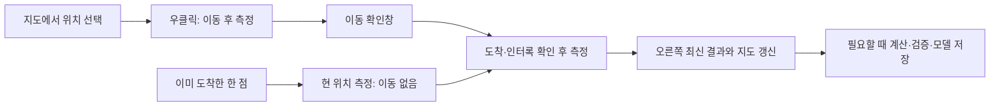

# Manual Inspection 측정·초기화 작업 흐름 · 11.21.2

브랜치 `feature/manual-inspection-measurement-20261121.2`, 기준 `d9c2779f888f1cc925c1515724a00038fe633bca`. master 병합 없이 검토한다. [화면 안내](README.md) · [최종 검증 manifest](validation.json)

## 1. 선택하고 측정하기

- **이동 후 측정**은 측정값만 취득한다. 보정 저장은 별도다. 오른쪽에 최신 측정 결과·X/Y 편차·OK/NG·Level을 표시한다.
- **현 위치 측정**은 확인창 없이 실행한다. 실제 도착이 확인된 한 점과 정지 상태를 확인하며 다른 위치로 자동 이동하지 않는다.
- **이동 후 측정 & 보정**은 대상 전체가 새 직접 측정 OK로 완료되어야 계산·검증·저장까지 진행한다. NG·중지·실패·잔여점이 있으면 자동 보정하지 않는다.
- 새 실측 결과가 들어왔을 때만 오른쪽 결과 영역을 자동으로 펼친다. 파일 열기·필터·단순 새로고침은 새 실측으로 취급하지 않는다.

확인창은 물리적 이동이 있는 동작에만 사용한다. 현재 위치 측정·대표 복사·Offset Init·계산·검증·저장·원복·가져오기/내보내기는 별도의 확인 팝업 없이 반응한다. 표준 파일 선택창은 유지한다. 확인창 생략은 Busy·인터록·버전·보정 한계·Field 검증 생략을 뜻하지 않는다.

## 2. 색상과 산포 해석

| 표시 | 의미 |
| --- | --- |
| 측정 편차 Level | 공통 X/Y 기준과 Level 경계로 모든 Cell·Head를 동일하게 분류 |
| 빨강 NG | 측정 판정 NG. 작은 편차라도 빨강 |
| 회색 초기화 | 명시적으로 측정 누적 보정을 초기화한 상태. 새 측정과 구분 |
| 실제 측정 0 | 유효한 실측값. Init 0으로 바꾸지 않으며 측정 Level로 표시 |
| 선택/대표 테두리 | 작업 대상/대표점. 출처 상세는 점의 툴팁에서 확인 |

산포 기본은 **측정 편차(WORKING)**다. 현재 Cell·전체 Cell의 Head별·선택한 Cell들 범위를 Auto로 맞추고, 고정 ±µm·확대/축소·더블클릭 맞춤도 제공한다. 초기화한 점은 기본 측정 산포에서 제외한다.

보조 **원측정 기록**은 보존한 실제 원값을 보고, **누적 보정량**은 저장된 B 또는 편집 중 작업 B를 본다. 누적 보정량은 현재 가공 후 잔류 오차가 아니다. 원편차 없이 기존 B로 표시한 점은 보정 기반 이력이며 새 직접 측정으로 승인되지 않는다. 초기화 뒤에도 원측정 기록은 이력으로 남을 수 있다.

## 3. 범위를 골라 Offset Init

1. 오른쪽 보정 영역에서 **모델 전체 / Cell / Head**와 대상을 고른다.
2. **Offset Init**을 누르면 해당 범위의 측정 누적 보정만 0인 초안을 만든다. 화면은 회색·미저장 상태이며 기존 활성값과 파일은 유지한다.
3. **모델 Offset 저장**으로 검증 후 새 누적 파일에 반영한다. 취소하려면 같은 위치의 **Offset 편집 취소**를 누른다.

대상은 Simple / Rough / Fine / One Shot / All Shot / Line Shot·대표 복사에서 누적된 Review 보정이다. **하드웨어·Default·First Beam·Distortion은 보존한다.** Cell/Head 바깥의 값도 보존한다.

저장 단위는 **Cell/Shot 한 값**이며 같은 Shot의 표시 Beam들이 공유한다. 한 Beam이 선택된 범위에 들어가면 같은 저장 Key를 공유하는 형제 Beam에도 초기화/보정이 반영된다. Head 범위에서도 이 저장 구조를 따른다.

초기화 저장 후 옛 잔차·대표 복사를 새 기준에 다시 누적하지 못하도록 현재 자격을 해제한다. 원측정·이력·이미 소비한 raw 기록은 지우지 않는다. 새 실측은 정상적으로 수행한다. 실제 측정 0을 저장하면 같은 Shot의 초기화 상태도 해제한다.

## 4. 저장·휴대·원복

측정 기반 Offset은 **현재 모델의 누적 절대값 하나**로 관리한다. 과거 Simple/Rough/Fine CSV를 다시 더하지 않는다. 기존 파일들은 이력으로 보존한다. 화면은 µm, Review Offset CSV와 통합 JSON의 Review 값은 DESIGN mm를 사용한다.

| 자료 | 11.21.2 처리 |
| --- | --- |
| 기존 CSV 필수 열 | CELLID / SHOTID / REVIEWOFFSETX / REVIEWOFFSETY 유지 |
| 선택 상태 열 | MEASUREMENT_STATE: INITIALIZED 또는 MEASURED |
| 선택 시각 열 | MEASUREMENT_INITIALIZED_AT: 초기화 시각, 시간대가 포함된 round-trip 형식 |
| 통합 JSON | `a3-manual-inspection-offsets/2`: 절대 Review 맵과 초기화 상태·시각 보존 |
| 이전 JSON | `/1`도 읽되 없는 초기화 상태를 0이라는 이유만으로 추정하지 않음 |

CSV의 `MEASURED`는 명시적 초기화 상태가 아니라는 뜻이다. 이 값만으로 카메라 실측 OK나 보정 적용 자격을 증명하지 않는다. 상태 열이 없는 이전 CSV도 읽을 수 있으며 0을 무조건 Init으로 바꾸지 않는다. `INITIALIZED`는 0 보정에만 허용한다.

통합 JSON은 보호 설정과 최종 좌표를 **참고 스냅샷**으로 함께 담는다. 불러오기는 Review 절대값 교체 초안이며 B에 다시 더하지 않는다. 하드웨어·Default·First·Distortion 설정이나 내보낸 Scanner 명령을 실행하지 않는다. 실제 모델 반영에는 저장이 필요하다.

**직전 보정으로 원복**하면 이전 Revision의 값과 초기화 상태를 새 Revision으로 저장한다. Init 0과 실제 측정 0을 값만 보고 구분하지 않는다. 과거 파일·원측정 이력·소비 기록은 유지하므로 옛 raw를 다시 누적하는 우회 경로가 되지 않는다.

원복 범위는 현재 작업에 등록된 Cell/Shot이다. 현재 모델 기하에 없는 옛 CSV 행 전체를 이전 파일로 교체하는 동작은 아니며, 미표시 행은 최신 파일의 값을 유지한다.

**파일 불러오기 전 작업으로 돌아가기**는 선택·필터·지도·산포·접기 상태를 되돌리는 기능이다. 실제 Stage 위치나 이미 저장한 활성 보정을 원복하는 기능과는 다르다. 조회 전용 모드는 두지 않으며 실제 작업 전 현재 모델·좌표·도달 조건을 확인한다.

## 5. 검증 범위

최종 수치와 SHA는 [manifest](validation.json), 시험별 근거는 [이번 QA](../../tests/ManualInspection/MEASUREMENT_WORKFLOW_QA.md)에 기록한다. 순수 상태 엔진, 실제 Controller+fake Backend, CSV 저장·다시 읽기, WPF 합성 렌더와 조작 회귀를 구분한다.

**실제 설비 App·SDK·PLC·Vision·모션·AeroScript·레이저는 실행하지 않았다.** 합성 검증 통과는 현장 도달 정밀도·통신 타이밍·가공 정밀도 검증을 대신하지 않는다. 이전 [11.21.1 설명](OFFSET_WORKFLOW_11.21.1.md)은 당시 정책 기록으로 보존한다.
