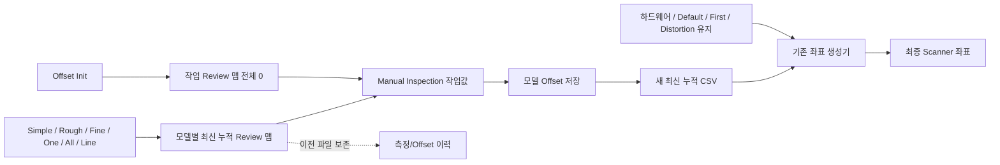

# Manual Inspection · 11.21.1 통합 Offset

브랜치: `feature/manual-inspection-offsets-20261121.1` · 기준: `50f02b0cc44e3b627b483d9b8fff54119abe8eab`. master에는 병합하지 않는다.

## 하나의 누적값으로 관리

Simple / Rough / Fine / One Shot / All Shot / Line Shot의 측정보정은 현재 Recipe(모델)의 **최신 누적 Review Offset 맵 하나**를 사용한다. 과거 CSV는 변경 이력이다. 과거 파일을 모두 다시 더하지 않는다. 같은 Cell/Shot의 Beam들은 기존 저장 형식대로 하나의 Review 보정값을 공유한다.

하드웨어·Default·First Beam·Distortion은 이 Review 맵과 별개다. 좌표계·Scale·Flip·Stage 추종을 고려해 기존 좌표 생성기가 합치므로, 서로 다른 좌표계의 숫자를 단순히 X/Y로 더하지 않는다.

## Offset Init → 모델 Offset 저장

1. **Offset Init**을 누르고 범위를 확인한다. 선택점만이 아니라 모델 전체의 측정 기반 Review 보정을 초기화한다.
2. 화면은 **작업 통합 Offset · 미저장**과 0값을 표시한다. 이때 실제 활성 보정과 기존 파일은 바뀌지 않는다.
3. 취소하려면 같은 위치의 **Offset 편집 취소**를 누른다. 이전 측정·후보와 실제 보정값을 유지한다.
4. 반영하려면 **모델 Offset 저장**을 누른다. 현재 좌표·총량·Field·Revision을 확인한 뒤 새 누적 파일로 저장한다. 기존 측정/Offset 파일은 남는다.

Init 저장은 현재 화면에 보이지 않는 기존 저장 행까지 처리한다. 하드웨어·Default·First Beam·Distortion 설정 파일은 수정하지 않는다. Init은 명시적인 전체 0 작업이므로 감소량에 대한 일반 측정 Δ 한계만 예외로 하며 총량/Field 검증을 유지한다.

저장 전 Init/통합파일 교체 작업값과 실제 활성값이 다른 동안은 **저장 또는 편집 취소 후 이동·측정**한다. 이 상태는 조회 전용 모드가 아니다. Init/파일 교체 저장 후에는 이전 잔차·대표 복사값을 새 기준에 다시 더하지 못하도록 현재 자격을 해제하고 원측정·이력·소비 기록을 보존한다. 새 측정은 정상적으로 진행한다.

## 통합 Offset 파일 하나로 휴대

`파일 → 통합 Offset 내보내기`는 JSON 하나에 아래를 담는다.

- 모델·버전·좌표 서명·단위, 누적 Review의 **절대 최종값**과 Cell/Shot 관계
- 하드웨어·Default·First·Distortion/좌표 변환 설정의 **참고용 스냅샷**
- 기존 생성기가 계산한 최종 Scanner 좌표와 각 보정 기여·Stage/Encoder 기준
- 현재 모델 기하 밖에 남은 과거 행은 별도 참고 이력

일반 미적용 측정 후보는 제외하고 실제 저장된 누적값을 내보낸다. Init/통합파일 편집 중에는 화면 작업값을 `isDraft: true`로 명시한다. JSON은 휴대용 사본이며 별도의 두 번째 활성 보정 저장소가 아니다.

`통합 Offset 불러오기`는 같은 모델·좌표 설정·기하·Head/Shot/Beam·단위를 확인한 뒤 **절대값 교체 초안**으로 연다. 기존 B에 다시 더하지 않는다. 같은 Shot의 추가 표시 Beam은 같은 값을 공유한다. 보호 설정과 내보낸 Scanner 명령은 적용하지 않으며 현재 설정으로 좌표를 계산한다. 모델 반영에는 **모델 Offset 저장**이 필요하다. 기존 측정 CSV 열기/내보내기는 별도로 유지한다.

## 조회 전용 없이 새 측정

예전 회차 자료·자동 보관 복구 실패·동기화 중지 때문에 화면을 조회 전용으로 고정하지 않는다. 현재 모델/실제 좌표 계획을 다시 연결해 새 측정할 수 있다. 불확실한 옛 raw는 새 직접 측정으로 승격하지 않는다.

다른 모델·회차·활성 Offset으로 바뀌면 예전 작업과 기존 보관 원문을 Recovery에 남기고 새 기준으로 연결한다. 새 기준의 유효한 보관 작업은 복원하되 자동 실행·이전 검증 승인은 재개하지 않는다. 바뀐 위치로 바로 움직이지 않고 대상을 다시 확인한다. 실제 Busy·알람·PM·도달/STOP·잘못된 좌표·저장 오류는 각각의 실제 원인을 안내한다.

## 산포도에서 데이터 확인

기본값은 **통합 Offset / 전체 Cell·모든 Head / Auto**다. 적용된 Review B의 DESIGN µm 분포를 표시하며, 새 측정 잔차가 B를 가리지 않는다. 원측정·작업 결과 보기는 별도로 선택한다.

- 통합 Offset: 실제 누적 보정량. 명시적 0 행도 데이터이며, 행이 없는 점을 가짜 0으로 만들지 않는다.
- 원측정: 실제 raw만 사용한다. 보정값을 원측정으로 만들지 않는다.
- 작업 결과: 현재 측정/대표 복사 결과, 원편차가 없으면 기존 보정 기반 표시를 사용한다.
- 현재 Cell / 전체 Head / 선택 Cell들 범위, Auto·고정 ±µm·확대/축소·더블클릭 맞춤을 유지한다.

누적 보정량과 가공 후 잔류 오차는 다른 지표이므로 통합 Offset 모드에는 잔류 측정 공차 박스를 그리지 않는다. 전체 Cell 전환 버튼도 제목 옆 한 개로 정리했고, 제목이 작은 경우에는 고정 위치의 한 개만 표시한다.

## 검증 범위

최종 결과와 소스/Assembly/그림 SHA는 [validation.json](validation.json)에 기록한다. [검증 코드](../../tests/ManualInspection/README.md)는 순수 엔진, 실제 Assembly Controller+fake 장비, 실제 CSV/순수 Recipe/Backend, 실제 WPF+합성값을 구분한다. 장비 App/Root/SDK·PLC/Vision/모션/AeroScript/레이저와 실제 보정 정밀도는 실행하지 않았다.
