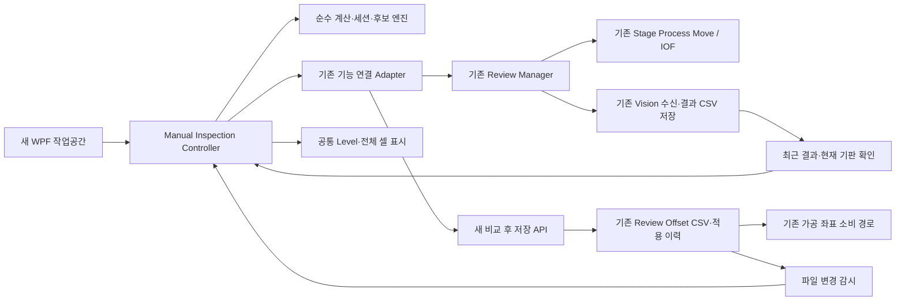

# MANUAL INSPECTION · 결과 동기화·공통 Level

사용자 첨부 [Review Workspace HTML](Reference/A3_Review_Workspace.html)의 작업공간을 **Correction → Review → MANUAL INSPECTION**에 별도 WPF 탭으로 구현했다. 기존 SIMPLE / INSPECTION, Default·Simple·Rough·Fine·Review Data 화면과 계산 방식은 유지한다. 기존 Light/Dark 테마의 패널·버튼·콤보·표를 사용한다.

- 기준: 이전 Manual Inspection `a062c701d825c925a8ba74184bc8eff98dce0ab6`의 후속. 원래 버전은 11.19.0+누락 Log 추적 수정 `334b359`다.
- 브랜치: `feature/manual-inspection-sync-levels-20261120`. **master 병합·배포는 하지 않았다.**
- 빌드: Windows / .NET 8 Windows Desktop, `dotnet build Drilling.sln -c Release`.
- 시험은 독립 하네스에서 진행했다. 실제 설비용 App·Root·장비 Manager·벤더 SDK·모션·AeroScript는 실행하지 않았다.

## 화면에서 하는 일

실제 WPF 하네스 미리보기(합성 데이터): [Dark](images/dark.png) · [Light](images/light.png). 실제 장비 화면을 캡처한 자료는 아니다.

| 작업 | 조작 |
| --- | --- |
| 최신 결과 확인 | `결과 새로고침`. 같은 Recipe·현재 기판의 외부 측정과 활성 Review Offset을 자동 확인 |
| 다른 결과 선택 | `더보기 → 최근 측정 결과 보기`. Rough/Fine/단동/Auto 등 목록에서 선택하거나 CSV 직접 선택 |
| 여러 위치 선택 | 클릭, Ctrl+클릭, 드래그, Ctrl+드래그 |
| 지도 확대 / 이동 | Ctrl+휠, Alt+드래그·방향키. **보기 이동이며 장비는 움직이지 않는다.** |
| 실제 작업 | 선택점 우클릭 또는 오른쪽 버튼 → 이동만 / 이동 후 측정 / 이동 후 측정 & 보정 |
| 현재 위치 측정 | 도착·정지 확인된 한 점만 가능. 복수점 측정은 이동 후 측정 사용 |
| Flying | 선택 Cell/Head/행/Beam의 유효한 행 전체를 확인 후 측정 |
| 대표값 복사 | 직접 실측 OK/NG를 대표로 지정 → 대상 선택 → 사유·최종 F·대상별 증감량 확인 |
| 보정 저장 | 계산 → 후보 검증 → 보정 적용·저장. 파일 저장 성공 후 활성값 갱신 |
| 원복 | 직전 활성 보정값을 **새 Revision**으로 저장. 기존 파일·측정·이력 보존 |
| 결과 확인 | 측정 결과 표, 점별 원시 값·전체 이력, 현재 Cell / 전체 Cell의 Head별 / 선택 Cell 산포도 |
| 작업 보관 | `더보기`의 CSV·세션 JSON, 같은 Run의 자동 세션 복구. 복구만으로 동작 시작하지 않음 |

기본 화면은 지도와 결과표에 집중한다. 상단은 **결과 새로고침 / 더보기 / STOP**, 오른쪽은 **선택점 측정 / 다른 동작 / 측정·출처 상세**다. 대표값 복사·보정·산포·상세 설정은 필요한 때 펼친다. SIM 예제·오류 주입·중복 이동/보정/Pan 도구 버튼은 제거했다. Alt 보기 이동과 우클릭 3동작은 유지한다.

이동·측정·계산·검증·보정 저장·원복·대표 복사·자료 전환 시 대상과 동작 설명을 읽고 확인한다. 취소하면 명령을 보내지 않는다. **STOP은 확인창 없이 즉시 요청한다.**

## 다른 메뉴 결과와 전체 셀 색상

- 결과·Offset 저장 폴더의 CSV 저장/이름 변경/삭제·폴더 반입을 감지해 갱신한다. 화면 진입 때도 다시 확인한다. 이 갱신은 장비를 움직이거나 보정 파일을 쓰지 않는다.
- 현재 Recipe·확실한 Glass·가공 회차의 시작 시각·Shift·Simulation 모드·Head/설계 좌표를 확인한 **점별 최신 결과**를 합친다. 구형/기준 미확인 파일은 최근 목록에서 선택해 조회한다. RETAINED·미검사를 새 직접 측정으로 합치지 않는다.
- 다른 기판, 과거 가공, Simulation 혼합, 좌표 불일치 결과를 현재 측정으로 자동 합류하지 않는다. 외부 파일은 IMPORTED 조회값이며 직접 실측 대표로 자동 승인하지 않는다.
- 측정/저장 중에는 갱신을 대기시킨다. 미완료 측정·미적용 후보가 있으면 보존하고 안내한다. 확인 후 새로고침하거나 잔여 측정을 완료한다. 외부 보정 Revision 변경 시 옛 후보를 바로 쓰지 않는다.

기본 지도는 **적용 보정값 B의 Level**이다. Rough/Fine의 보간·확장 결과나 대표값 복사가 활성 CSV에 저장되면, 실제 행이 있는 **모든 Cell/Shot/표시 Beam**을 같은 DESIGN µm 임계값으로 표시한다. 아직 측정하지 않은 좌표도 보정 행이 있으면 Level이 나온다. 저장하지 않은 후보 F는 적용 색상에 포함하지 않는다.

| 보기 | 색상의 뜻 |
| --- | --- |
| 적용 보정값 · Level (기본) | 실제 활성 CSV의 B. 행 없음은 회색, 명시적 0 보정 행은 L1 |
| 측정 편차 · Level | 작업 측정 편차의 등급. 수신 오류·미측정은 0 측정으로 만들지 않음 |
| 측정 판정 | OK/NG/ERROR 등 측정 상태 |

기본 공통 기준은 `MAX_AXIS = max(|X|, |Y|)`, 상한 5 / 10 / 20 µm다. 모든 Cell/Head에 같은 기준을 적용한다. 예를 들어 B=(6,−8) µm는 어느 셀에서도 L2다. RADIAL로 바꾸면 벡터 크기에 같은 경계를 사용하며, 설정 변경은 원측정·활성값을 바꾸지 않는다. 적용 보정 크기는 가공 후 잔류 정밀도와 구분한다.

대표값을 복사하면 대상의 **작업 편차·판정과 최종 보정 F**가 대표를 따른다. 대상의 실제 원측정은 덮어쓰지 않고 MANUAL / 대표 키 / 사유를 남긴다. NG 대표는 NG 상태도 복사하지만 보정 파일 적용은 차단한다. 복사본은 다시 직접 실측 대표로 사용할 수 없다.

산포도의 `원측정`과 `작업 결과`를 구분한다. 측정 없는 점은 0으로 그리지 않는다. 헤더 좌표는 **마지막 도착 확인값**이며 실시간 모터 위치 표시가 아니다.

## 실제 코드 연결

- UI: `Drilling.UI/Views/CManualInspection*`. 지도/산포는 그리기 컨트롤이며 점마다 WPF 컨트롤을 생성하지 않는다.
- 계산: `Drilling.Common/Review/ManualInspection`. 단위는 DESIGN µm, 원시 Vision/Stage 값은 별도 보존한다.
- 연결: `CManualInspectionController`, `CManualInspectionBackend`. 기존 Review Manager의 실행 잠금, Process Move·도착 확인·Vision 수신·공식 결과 저장을 사용한다.
- 좌표: `CManualInspectionCoordinateBridge`. Vision Flip 1회 → 기존 Head/Design 변환 → µm. 결과 CSV의 VISION_FLIP_CONVERT에는 Flip을 재적용하지 않는다. 활성 파일은 DESIGN **mm**로 저장한다.
- 저장: `CReviewOffsetFile.SaveNewIfUnchanged`. 실제 최신 파일을 잠금 안에서 비교하며 오래된 Revision·동일 출처 중복을 거부한다. 기존 Save/Load/Rollback 본문은 유지한다.

같은 Cell/Shot의 여러 Beam은 기존 CSV의 **하나의 보정 저장 키**를 공유한다. 서로 다른 최종 F를 요청하면 저장을 거부하며, 적용 후 형제 Beam의 현재 B도 같은 값으로 갱신한다. 직접 측정은 B+편차, 대표 복사는 대표의 확정 F를 사용한다. 이미 적용한 대표 raw를 다시 더하지 않는다.

## 실패·중지 처리

- MANUAL / PM 잠금 해제 / MAIN Ready / HEAVY 알람 없음 / 다른 Review·Stage 작업 없음에서 실행한다. Stage 정리 미완료도 차단한다.
- STOP은 즉시 취소를 요청하지만 실제 이동·측정 정리 반환 전에는 작업 잠금을 풀지 않는다. 정보창을 닫는 것 때문에 장비 알람 정리가 지연되지는 않는다.
- ERROR·수신 없음은 잔여로 남긴다. NG는 측정 완료이나 자동 보정 불가다. `잔여 재실행`은 측정만 하며 자동 보정을 재개하지 않는다.
- P2P는 공식 결과 저장 성공 후 완료를 반영한다. Flying도 행별 결과 저장 성공 후 반영하며, 각 단일행 요청의 번호를 1로 맞춘다.
- 첫 세션 저장이 실패하면 장비를 움직이지 않고 오류/잔여 상태로 종료한다. 경로를 복구한 후 잔여 재실행이 가능하다.
- 저장 직전 Recipe·Run·좌표 설정·활성 Revision을 다시 확인한다. 같은 Run/점/raw의 소비 이력을 세션과 적용 이력으로 보존한다.
- 구형/외부 결과는 IMPORTED로 구분한다. 현재 Run의 직접 실측으로 오인해 보정 앵커로 쓰지 않는다. 다른 기판 자료는 조회 전용이다.

## 저장 위치와 정밀도

| 자료 | 위치·단위 |
| --- | --- |
| 공식 측정 결과 | 기존 `Data/Review/...` 경로·기존 저장기 |
| 활성 보정 | 기존 `Config/RECIPE/<Recipe>_reviewoffset/...` 저장기 경로·기존 형식, DESIGN mm |
| 세션·소비 원본 예약 | `Data/ManualInspection/Sessions`, `Data/ManualInspection/ApplySources` |
| 내부 검증·기존 SIM 세션 | `Data/ManualInspection/Simulation` 아래 격리. SIM 예제/주입 UI는 제거 |

파일 저장 정밀도는 0.000001 mm(0.001 µm)이며 기존 가공 소비 코드는 0.001 mm(1 µm)로 반올림한다. 새 탭은 이 기존 가공 동작을 변경하지 않는다. Field 검사는 실제 소비할 반올림값·REVIEW_OFFSET_SCALE과 현재 Default/First/Align/Shift 기여를 사용한다. MOF Stage 추종 성분을 정지 Field 오차로 오인하지 않는다. 이 검사는 장비 실제 소프트리밋·동역학 검증을 대신하지 않는다.

## 확인한 결과와 남은 현장 항목

| 검증 | 결과 |
| --- | --- |
| 전체 솔루션 Release | 경고 0 / 오류 0 |
| 계산·상태·세션 | 111/111 |
| 좌표·실제 CSV writer | 22/22 |
| 실제 UI 프로젝트 참조 Controller | 65/65, 벤더 Assembly 로드 0개 |
| 외부 결과 병합 | 37/37, 실제 Common·합성 파일/기하 |
| 실제 WPF UI / 추가 연결 검사 | 49/49 + 23/23 + 34/34, Light/Dark·10,000점 |
| 첨부 HTML oracle | 이전 구현의 14/14 기록. 후속 단순화는 새 WPF 검사로 확인 |
| 기존 화면·변경 범위 보존 | 12/12, 결과 저장 제어흐름·구화면·Theme/Config/Data 보존 |

재현 명령과 범위는 [테스트 안내](../../tests/ManualInspection/README.md), [UI 대조표](../../tests/ManualInspection/HTML_PARITY_CHECKLIST.md), [독립 검토](../../tests/ManualInspection/SYNC_QA.md)를 참조한다. 결과별 범위와 소스 SHA는 [validation.json](validation.json)에 기록했다. HTML/WPF/순수 계산/파일 시험을 실장비 시험으로 합산하지 않는다.

추가 확인 사항:

1. **실장비**: Process Move 도착·Busy·STOP 신호 정리, P2P/Flying 트리거·결과 수·UID, 외부 Product 변경·디스크 오류, 기존 Correction의 장비 회귀.
2. **실제 한계 승인**: 화면 초기 증감 30 µm / 총량 200 µm 등은 현장 허용값으로 확인 후 조정한다. Field는 실제 Head 설정과 화면 한계 중 작은 범위를 적용한다.
3. **기존 설정 관찰**: 소스의 test0929 설정으로 순수 planner 20,740점을 대조했을 때, Masking/Chess 제외 후 19,525점 중 **90점이 기존 값 그대로도 ±55 mm Field 밖**이었다. 최대 55.9815 mm. 새 기능 오류나 실제 장비 불합격으로 단정하지 않으며 실제 Recipe·설정을 확인해야 한다. 이 경우 검증을 임의로 통과시키지 않는다. 설정 원문·운영 측정 레코드는 이 브랜치에 복제하지 않았다.
4. **새 가공으로 검증**: 보정 저장만으로 이미 가공된 기판의 구멍이 움직이지 않는다. 새 가공 Run을 만든 뒤 재측정해 정밀도를 확인한다. SIM도 같은 Run의 구멍은 그대로 유지한다.
