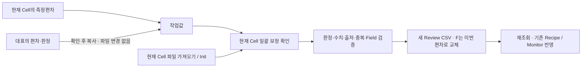

# 측정편차로 교체하고 일괄 저장 · 11.24.8

기준: 11.24.7 `35ef09b13dddb2d581582689e34978b9ac285d39`. 작업 브랜치는 `feature/manual-inspection-replacement-workflow-20261124.8`이며 master에 병합하지 않는다.

## 바뀐 사용 순서

1. Cell 하나를 열고 측정하거나 편차를 입력한다.
2. 필요한 경우 대표점을 정하고 **같은 편차·상태 복사**를 누른다. 확인 후 대상의 작업 편차와 판정만 교체한다. 이때 CSV는 저장하지 않는다.
3. **현재 Cell 일괄 보정·CSV 저장**을 누르고 확인한다. 유효한 OK 편차를 검증한 뒤 새 최종 Review CSV를 만든다. 다른 Cell은 유지한다.

**새 Review Offset = 현재 측정편차 X/Y**이다. 기존 Review Offset에 다시 더하지 않는다. 예를 들어 기존값이 100 µm, 현재 편차가 2 µm이면 새 CSV는 **2 µm**이다. 대표의 편차가 3 µm이고 대상의 기존값이 20 µm여도 대상은 **3 µm**가 된다.

이 변경은 요청에 따른 **Manual Inspection의 저장 정책**이다. 다른 Inspection 메뉴의 Simple/Rough/Fine 계산·누적 방식을 바꾸거나, 실기 잔차 보정 방식 자체의 타당성을 입증한 것은 아니다. 하드웨어·Default·First Beam·Distortion·Align·Shift 등 다른 종류 Offset도 바꾸지 않는다.

## 화면에서 없앤 것

- 최종 Review 보정 Level / OK·NG 색 모드 전환: **측정편차 Level** 하나로 통일한다. OK·NG 판정 필터는 유지한다.
- 선택점 보정 계산·후보 검증·후보표·별도 모델 Offset 저장·수동후보 허용 체크: 일괄 저장 안에서 처리한다.
- 최종값 지도 이동·최종값 산포 전환·여러 범위의 Init 선택: 현재 편차 보기와 현재 Cell Init으로 단순화한다.

기존 테마, 2D 지도, 다중 선택, 우클릭 이동/측정, 숫자 키패드, 확대·맞춤, 표 접기, 산포의 Cell/Head 범위는 유지한다. NG는 Level과 관계없이 빨강, 유효 편차가 없는 점과 초기화된 점은 회색이다. **실제로 측정한 0은 유효값**이다.

저장된 Review 값만 있고 해당 편차 원문이 없는 경우, 저장값을 새 측정편차로 만들어 표시하지 않는다. 새로 측정하거나 X/Y를 입력해야 숫자 편차로 복사·보정할 수 있다. 원측정/사용자 확정/대표복사/불러온 Offset의 출처를 구분한다.

## 가져오기와 초기화

| 작업 | 화면 준비 | 일괄 보정·CSV 저장 후 |
| --- | --- | --- |
| 통합 Offset 가져오기 | JSON/CSV 전체를 검증하고 **현재 Cell** 값만 준비 | 해당 Cell Review를 파일 값으로 교체, 다른 Cell 보존 |
| 현재 Cell Offset Init | 해당 Cell 측정 보정을 **값 없음**으로 준비 | 해당 Cell 측정 Review를 0/Init 상태로 저장, Level은 회색 |
| 편집 취소 | 저장 전 가져오기/Init 작업 취소 | 실제 활성 CSV와 원측정은 변경 없음 |

전체 Cell 화면에서는 저장할 Cell을 먼저 열어야 한다. 미저장 파일/Init 작업의 Cell과 현재 Cell이 다르면 저장하지 않는다. 모델 전체로 대상이 넓어지지 않는다.

가져온 파일 값은 카메라가 방금 측정한 원문이 아니다. 준비 중에는 출처를 표시한 파일 입력으로 미리 본다. 저장 뒤 해당 값만 남고 현재 편차 원문이 없으면 지도는 회색이며, 이는 CSV 저장 실패를 뜻하지 않는다. 기존 원측정은 별도 원측정 보기로 보존한다. CSV에는 모델 ID/좌표 서명이 없으므로 현재 모델 Cell/Shot·단위·좌표계·중복·수치·상태 검증과 사용자 확인을 거치며, 파일 자체만으로 원래 모델을 입증하지 않는다. 기존 JSON의 모델/좌표 서명 검증은 유지한다.

과거 버전의 모델 전체 편집 초안은 현재 Cell 작업으로 임의 해석하지 않는다. 취소 후 현재 Cell에서 다시 가져오거나 초기화한다. 원측정과 과거 보정 파일은 보존한다.

## 저장·이력·보호

- 저장 위치는 실제 활성 Recipe의 `Config/RECIPE/<모델>_reviewoffset/`이다. 새 `*_reviewoffset.csv`를 만들고 재조회하여 Revision·전체 값·Init 상태를 대조한다.
- 파일 메뉴의 **현재 Offset CSV 내보내기**는 마지막으로 저장된 모델 전체 CSV의 원문 복사본이다. 미저장 화면값을 저장하는 기능은 아니다. 기본 이름은 `_export.csv`이며 활성 보정 선택을 바꾸지 않는다.
- NG·미측정·Masking·유효 편차 없음·한계 초과·이미 적용된 동일 결과는 일괄 대상에서 제외한다. 같은 Shot의 상충된 Beam 결과와 Field/현재 기준 오류는 저장을 막는다.
- 새 입력 한계는 **이번 편차 자체**에 적용한다. 기존값 500 µm를 새 편차 5 µm로 교체할 때, 기존값을 빼는 차이 −495 µm를 새로운 측정편차로 오해하여 차단하지 않는다. 최종값·Field·원본 증빙 검증은 유지한다.
- 이전 버전에서 이미 적용한 수동/복사 결과도 새 작업 없이 다시 저장하지 않는다. 새 규칙으로 바꾸려면 명시적으로 새 편차 입력/확정 또는 대표 복사를 한다.
- 확인창 중 Cell/기준이 바뀌거나 중복 요청이 들어오면 실행하지 않는다. 이미 적용한 같은 결과를 다시 눌러 파일을 반복 생성하지 않는다.
- 되돌리기/다시 적용은 최대 10단계의 저장된 보정 이력을 사용한다. 현재 Cell 밖 값·상태, 원측정, 소비 기록은 임의로 덮어쓰지 않는다.
- 저장 완료와 저장 뒤 재조회 실패는 구분한다. 재조회 실패를 다시 보정하라는 의미로 표시하지 않는다. 기존 Monitor/Recipe의 최신 CSV 반영 경로는 그대로 사용한다.

## 검증 범위

### 같은 저장값을 프로그램 전체에서 사용

최종 Review 값의 공통 기준은 같은 모델의 최신 `*_reviewoffset.csv`다. 화면별로 별도의 최종값을 저장하거나 현재 작업 편차를 이중으로 더하지 않는다.

| 소비 경로 | 최신 저장값 반영 |
| --- | --- |
| Manual Inspection | CSV 저장 후 재조회·Revision/값/Init 대조. 지도 색은 요청대로 현재 **측정편차**를 표시하므로 CSV 최종값과 색의 의미는 구분한다. |
| Correction의 다른 Review | 화면 진입·계획 재작성 때 최신 CSV를 공통 파라미터에 합친다. 자체 측정 원문과 최종 Review는 구분한다. |
| Recipe 좌표 미리보기 | 저장 CSV 투영을 갱신하며 편집 중인 Recipe 원본을 덮어쓰지 않는다. |
| Monitor Coordinate Viewer | 같은 CSV의 DESIGN 저장값과 실제 Scanner 적용 기여를 구분한다. Scale/축변환 뒤 값은 원저장값과 다를 수 있다. |
| 자동/수동 MOF → A1 생성 | 가공 준비 때 최신 CSV로 파라미터·공통 좌표 계획을 만들고 A1 파일을 생성한다. |
| Shift 사전 미리보기 | 이번에 오래된 Review 키를 제거하고 최신 CSV를 합치도록 보완했다. 기존 명목 Glass/Head 범위 검사를 모든 실제 보정의 물리 Field 검증으로 과장하지 않는다. |

**저장 전 만들어진 가공 준비/스크립트를 그대로 사용하지 않는다.** 보정 저장은 준비된 모델을 무효화하며, 다음 가공은 DoReady를 다시 실행해 최신 값으로 준비해야 한다. 준비 후 파일이 달라져도 기존 Station 검사가 실행을 막는다. 이 Station 동작은 소스 추적으로 확인하며 실제 장비를 시작하는 시험은 하지 않는다.

합성 시험에서는 실제 CSV·공통 좌표 계획·실제 A1 텍스트 생성기를 연결해 `PROCESS_COORDINATES.csv`와 Head 스크립트의 Review/Scanner 좌표를 비교한다. 생성한 AeroScript는 **업로드·실행하지 않는다**. 기하학적 목표점·고정 하드웨어 설정·측정 잔차·축변환된 가공 좌표를 모두 같은 숫자로 덮어쓰는 방식은 사용하지 않는다.

[가공 준비·최신값 검사](../../Drilling.Common/Station/CStationProcess.cs) · [실제 A1 생성기](../../Drilling.File/Script/CAutomation1ScriptFile.cs) · [공통 좌표·Review overlay](../../Drilling.Common/Recipe/CShotCoordinatePlanBuilder.cs) · [Shift 입력 결합](../../Drilling.UI/CRootView.cs)

[최신 manifest](validation.json)에 Release 빌드, 실제 Controller DLL 시험, 실제 CSV parser/writer를 사용하는 합성 시험, 순수 엔진, WPF 다크/라이트 렌더, 3회 교차검토와 소스/DLL SHA를 기록한다. 원측정 보존, 비영점 기존값 교체, 복사 직후 저장 0회, 일괄 뒤 1회, 재클릭 추가 0회, 다른 Cell·실측 0·Init·숨은행 보존을 확인한다.

생산 `SaveCoreAsync`의 설비 Manager 경계는 시험용 seam으로 대체한다. 설비 App/Root/Manager·PLC/Vision·모션·AeroScript·벤더 실행·레이저·기판 가공·물리 정밀도는 실행하지 않는다. 운영 CSV 실제 레코드와 비공개 작업실은 게시하지 않는다.

[Manual Controller](../../Drilling.UI/Menu/Menus/CManualInspectionController.cs) · [순수 엔진](../../Drilling.Common/Review/ManualInspection/CManualInspectionWorkspace.cs) · [화면](../../Drilling.UI/Views/CManualInspectionView.xaml) · [CSV 연결](../../Drilling.UI/Menu/Menus/CManualInspectionBackend.cs)

Release 빌드 **경고 0 / 오류 0**, 순수 Core **271**, 실제 Controller **285**, 실제 Backend/CSV/표시/A1 생성 **183**, writer **35**, 범위 **48**, 실제 .7 JSON 호환 **32**, WPF **19모드 1,031** 검사를 통과했다. 소스 링크 Controller **282**는 실제 DLL 시험과 중복 합산하지 않는다. 이전 UI의 삭제된 후보/최종색 조작 시험은 새 동작으로 대체하고 지도·키패드·다중 선택·상태·원측정 보존 시험은 유지했다.

[Dark 화면](images/manual-11.24.8-replacement-dark.png) · [Light 화면](images/manual-11.24.8-replacement-light.png)
