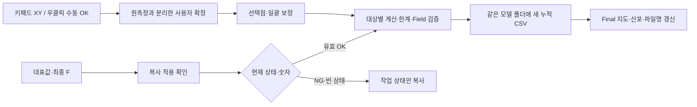
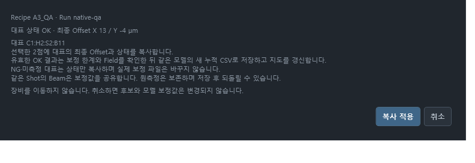
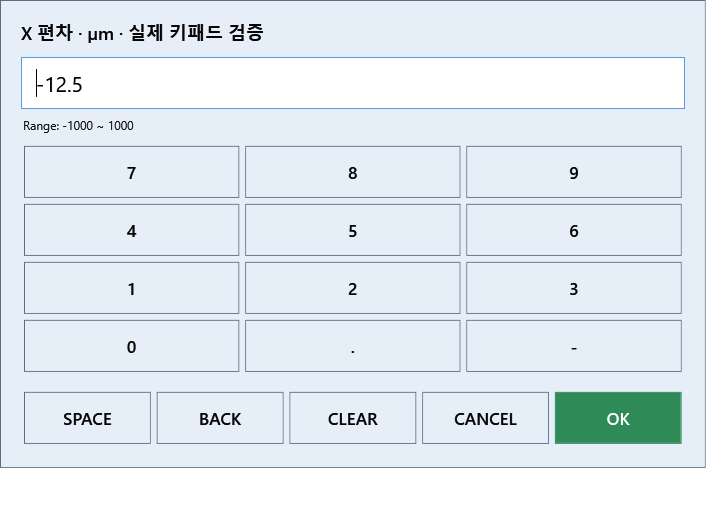

# 대표값 실제 적용·수동 OK·편차 키패드 · 11.24.5

기준 `c0a169548edef5975ea454389071dd7c22c625bd` → `feature/manual-inspection-representative-apply-20261124.5`. master에는 병합하지 않는다.

## 무엇이 문제였나

기존 **같은 오프셋·상태 적용**은 작업값과 후보만 바꿨다. 기본 지도는 저장된 최종 CSV를 표시하므로, 복사해도 지도가 그대로였다. 또한 기존 저장값을 복사한 결과는 잔류 편차가 없을 수 있는데, 유효한 최종값 F가 있어도 숫자 편차가 없다는 이유로 보정 대상에서 빠졌다.

## 바뀐 사용 방법

| 조작 | 결과 | 보정 파일 |
| --- | --- | --- |
| 대표 지정 → 대상 선택 → 같은 오프셋·상태 적용 | 확인창에서 대표·상태·값·대상 수를 확인하고 적용 | 유효한 OK는 새 누적 CSV 저장 후 최종 지도 갱신 |
| NG·미측정 대표의 상태 복사 | 대표 상태를 복사하며 원측정은 보존 | 변경하지 않음 |
| 우클릭 **측정 완료·OK로 변경** | 기존 유효 숫자를 사용자 수동 OK로 확정 | 선택점·일괄 보정에서 따로 저장 |
| 단일 Cell의 측정점 더블클릭 / 우클릭 **편차 직접 입력** | 기존 숫자 키패드로 X, Y 편차를 µm 단위로 입력해 수동 OK로 기록 | 선택점·일괄 보정에서 따로 저장 |
| 빈 공간·전체 Cell의 더블클릭 | 기존 화면 맞춤 | 변경하지 않음 |

키패드 두 축 중 하나라도 취소하면 입력을 반영하지 않는다. 입력 중 모델이나 결과 기준이 바뀌어도 반영하지 않는다. 값이 없는 점에 자동으로 0을 넣지 않는다.

기존 저장 B를 승인하는 경우에는 **알려진 최종값**을 승인한다. 잔류 편차는 없는 그대로 유지하며, 측정 오차 0이나 비전 실측 OK를 새로 만들지 않는다. 실제 비전 원측정과 사용자 수동 확정은 별도로 기록·표시한다. 유효한 저장값이 존재하는 보정 기반 위치와 진짜 빈 값/Init도 구분한다.

## 적용 기준

- 복사는 대표의 **최종 F를 절대값으로 지정**한다. 대상의 기존 B에 대표 F를 또 더하지 않는다.
- NG·미측정·유효 숫자 없음·수치 한계 초과·이미 같은 값으로 적용된 위치는 보정 대상에서 제외하고 이유를 알린다. 수치 한계는 기존 엔진의 최대 축 절댓값 기준을 따른다.
- Field·현재 모델/회차·파일 기준·Masking·같은 Shot의 Beam 충돌 검증은 유지한다. 같은 Shot이 서로 다른 F를 요구하면 일부만 임의로 저장하지 않는다.
- 사용자 수동 확정은 원측정·원래 판정·사용한 측정 이력을 지우지 않는다. 새 실측이 들어오거나 Init하면 작업의 수동 확정 상태는 그에 맞춰 정리된다.
- 다른 파일 작업으로 저장 B가 바뀐 뒤 원래 화면으로 돌아오면 옛 수동 확정값은 정보로 보관한다. 현재 B에서 다시 수동 확정하거나 편차를 입력해야 보정 대상으로 쓸 수 있다.
- 확인창 취소·연속 클릭·같은 입력의 반복으로 보정을 중복 누적하지 않는다. 저장된 변경은 기존 10단계 Undo/Redo를 사용한다.

최종 저장소는 계속 `Config/RECIPE/<모델>_reviewoffset/`의 최신 CSV다. 보호 Offset·기존 CSV·다른 Correction 메뉴를 별도 수정하지 않는다.

## 구현과 검증 근거

[작업 엔진](../../Drilling.Common/Review/ManualInspection/CManualInspectionWorkspace.cs) · [수동 근거 모델](../../Drilling.Common/Review/ManualInspection/CManualInspectionModels.cs) · [저장 연결](../../Drilling.UI/Menu/Menus/CManualInspectionController.cs) · [화면·확인·키패드](../../Drilling.UI/Views/CManualInspectionView.xaml.cs) · [지도 입력](../../Drilling.UI/Views/CManualInspectionMapControl.cs) · [기존 숫자 키패드](../../Drilling.UI/Popup/CValueInputDialog.xaml.cs)

최종 검사 수·소스/DLL 해시·독립 검토는 [현재 검증 기록](validation.json)을 따른다. 합성 소프트웨어 검증과 실제 장비의 통신·모션·레이저 검증은 구분한다.

실제 CSV 연결 검증의 저장용 시험 경로는 생산의 읽기·좌표 변환·검증 함수와 실제 CAS 저장기를 사용한다. 장비 Manager가 필요한 생산 SaveCore의 운전 가드를 통과했다고 주장하지 않으며, 합성 저장 연결과 실제 장비 실행을 구분한다.

Release 빌드 경고/오류 **0/0**. Core **248**, 실제 Controller **261**, Backend **134**(실제 CSV 저장 연결 3개 포함), 좌표/CSV 저장 **35**, 외부 결과 **53**, WPF **16모드 976**, 변경 범위 **26** 검사를 통과했다. 소스 링크 Controller 258개는 실제 DLL 검사와 중복 집계하지 않았다.

