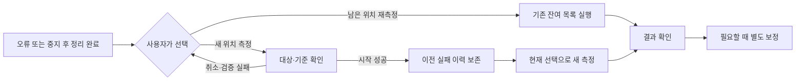

# Manual Inspection · 11.24.0

브랜치: `feature/manual-inspection-retry-visibility-20261124.0`

기준 Commit: `3a2526dacf988cf303a102dc432a6eaa9394e9d4`

master 미병합. 기존 테마·실제 셀 배치·보정 수식·원래 CSV writer는 유지한다.

## 셀 번호와 측정 표시

- 전체 셀 번호의 글자·여백·표시 영역을 화면에 그려진 셀 크기에 비례해 조절한다. 이전의 고정 11 DIP 글꼴·최소 65×21 박스·셀 밖 라벨 배치를 제거했다.
- 라벨은 실제 셀 다각형 안에서 표시한다. 일부만 화면에 보이는 셀도 보이는 영역 안에 맞추며, 회전 셀·셀 번호 클릭·드래그 다중선택을 유지한다.
- 극도로 축소하면 번호도 작아진다. 번호가 읽기 어려우면 Ctrl+휠로 확대한다. 번호를 크게 유지해 작은 셀을 가리는 방식으로 되돌리지 않는다.
- 진행 중인 측정 대상은 **0.5초마다** 금색 윤곽과 십자가를 켜고 끈다. 원래 OK/NG·Level 색·선택·측정값은 바꾸지 않는다.
- P2P는 현재 요청 중인 점, Flying은 Backend가 알려준 **현재 실행 행의 대상들**을 표시한다. SIM은 실제로 순서 실행하는 합성 점만 표시한다. 모터 피드백의 실제 현재 위치라고 추정하지 않는다. 완료·실패·정리 완료·숨김·화면 해제 후에는 점멸을 종료한다.

[축소한 48셀](images/manual-11.24.0-48cells-light.png) · [점멸 ON](images/manual-11.24.0-blink-on-dark.png) · [점멸 OFF](images/manual-11.24.0-blink-off-dark.png)

그림은 실제 WPF에 합성 데이터를 넣어 렌더한 검증 화면이다. 실장비 캡처가 아니다.

## 실패 후 다른 위치 측정

이전에는 오류/중지로 남은 목록이 있으면 `남은 위치만 재측정` 외의 새 측정을 엔진에서 거절했다. 실제 동작이 이미 종료된 경우에도 사용자가 새로 선택한 위치로 진행할 수 없었다.

이제 다음 중 하나를 선택한다.

1. **남은 위치만 재측정:** 현재 미완료 목록만 다시 측정한다. 완료한 결과를 재측정하거나 자동 보정하지 않는다.
2. **새 위치 선택 → 이동 후 측정:** 확인 후 지금 선택한 위치로 새 작업을 시작한다. 현 위치 측정은 기존처럼 이동 확인창 없이 실행하며 실제 위치 검증은 유지한다.

선택이나 확인창 열기만으로 이전 목록을 없애지 않는다. 유효한 새 작업의 시작 검증이 성공한 순간에 전환한다. 확인 취소·오래된 요청·Masking만 선택·아직 실제 동작 중인 경우에는 이전 목록을 유지한다. STOP은 정리 완료까지 새 동작을 허용하지 않는다.

이전 작업의 대상·완료·잔여·오류는 기존 Audit의 `OP_SUPERSEDED`로 보관한다. 완료한 측정·원측정 이력·저장된 보정값·중복 적용 기록은 보존한다. 다만 이전 잔여 위치가 새 측정 응답도 받지 못했다면, 그 위치에 남아 있던 **옛 작업 편차를 현재 보정 후보로 재사용하지 않도록** 작업값의 자격을 해제한다. 이를 원측정 이력 삭제와 혼동하지 않는다. 다른 위치 측정을 완료했다는 이유로 실패 위치의 옛 편차가 일괄 보정에 들어가지 않게 한다.

## Monitor · Coordinate Viewer · Shot Detail

저장된 최신 모델 Review Offset → 임시 파라미터 → 실제 좌표 Planner → Shot Detail의 `REVIEW OFFSET` 행 → 속성 갱신 경로를 실제 저장 파일로 검증했다. 선택점/일괄 보정 후의 저장값을 읽는 경로는 공통이며, 저장하지 않은 초안은 Monitor에 적용하지 않는다. Recipe 편집값을 저장된 Review Offset으로 덮어쓰지 않는다.

확인·개선한 부분은 다음과 같다.

- 최신 파일을 모델 ID·행 검증 후 적용한다. Recipe/Setting에 남은 오래된 Review 값보다 최신 저장 행이 우선한다.
- DESIGN 좌표 요약에서 GX/GY 기여분을 직접 더하던 오류를 수정했다. 현재 Head의 축 교환·반전과 주행 방향을 고려해 DESIGN으로 변환한다. 가공/리뷰 좌표 수식 자체는 변경하지 않았다.
- `REVIEW OFFSET`은 **현재 선택한 좌표계에서의 적용 기여분(mm)** 이다. 6자리 소수로 표시해 0.1 µm보다 작은 값도 이전처럼 쉽게 0으로 반올림되지 않게 한다. 예: 0.012 µm → 0.000012 mm.
- 행의 툴팁에 원래 저장값의 DESIGN/SCANNER 구분, mm 값, `REVIEW_OFFSET_SCALE` 비율을 표시한다. 비율 0%이면 저장값이 있어도 적용 기여분은 0이다. 이 상황을 저장 실패로 해석하지 않는다.
- 값 없음/Offset Init은 `—`, 실제 측정·저장한 0은 `0.000000`으로 구분한다.
- 같은 Shot을 선택한 상태에서도 저장 파일 revision이 바뀌면 갱신한다. 같은 revision의 정상 읽기는 이전 오류 상태를 해제해, 이후 재발한 읽기 오류를 다시 안내할 수 있게 한다.
- Review Camera 기준의 검사 타겟에 가공 Review Offset을 다시 더하지 않는 기존 정책은 유지한다.

운영 시에는 **같은 모델·같은 Cell/Shot·좌표계·mm 단위·적용 비율**을 함께 확인한다. 같은 Shot의 여러 Beam은 한 저장 Review Offset을 공유한다.

## 보정 제한과 검증 범위

NG·미측정·Masking·값 없는 점은 실제 선택점/일괄 보정에서 계속 제외하거나 검증 실패 처리한다. 대표점으로 지정할 수 있다는 것과 실제 보정에 사용할 수 있다는 것은 구분한다. 중복 적용 방지·확인창·10단계 Undo/Redo·보호 Offset은 유지한다.

[3회 교차검증](../../tests/ManualInspection/RETRY_VISIBILITY_QA.md) · [최종 manifest](validation.json) · [이전 11.23.2](STANDARD_SELECTION_REFERENCE_11.23.2.md)

장비 App/Root/Manager·벤더 SDK·PLC·Vision·실모션·AeroScript·레이저는 실행하지 않았다. 점멸은 UI 타이머이며 실시간 모션 상태 보장이 아니다. 실제 설비 도달·인터락·Vision 지연·가공 정밀도는 현장 검증 대상이다.
